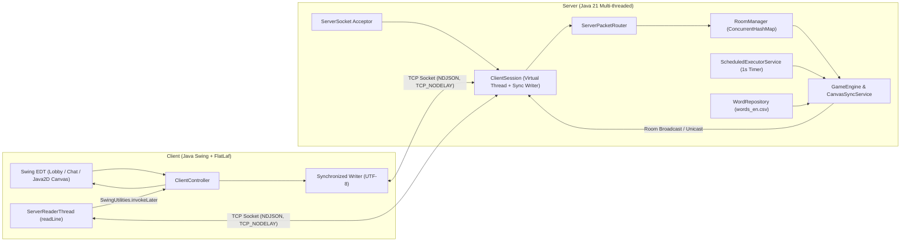
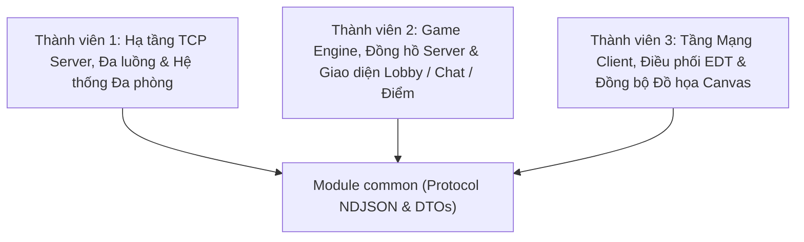

# KẾ HOẠCH XÂY DỰNG HỆ THỐNG SKRIBBL MULTIPLAYER (JAVA 21)


---

## 1. Tổng Quan Công Nghệ & Quyết Định Thiết Kế Đã Chốt

| Hạng mục | Lựa chọn chốt | Mục đích & Giải pháp kỹ thuật trọng tâm |
| :--- | :--- | :--- |
| **Ngôn ngữ** | **Java 21 LTS** | Sử dụng `record` cho DTO bất biến, `Executors.newVirtualThreadPerTaskExecutor()` quản lý kết nối đồng thời, Pattern Matching cho bộ định tuyến bản tin. |
| **Giao tiếp mạng** | **TCP Socket thuần** | `ServerSocket`, `Socket`, `BufferedReader`, `BufferedWriter` với `StandardCharsets.UTF_8` và bật `socket.setTcpNoDelay(true)` (tắt Nagle's algorithm) để truyền nét vẽ thời gian thực không trễ. |
| **Định dạng bản tin** | **NDJSON + Jackson** | **Newline-Delimited JSON**: Mỗi bản tin JSON nằm trên đúng **1 dòng** kết thúc bằng `\n`. Dễ debug trực tiếp trên Console khi bảo vệ đồ án. |
| **Giao diện (GUI)** | **Java Swing + Java2D + FlatLaf** | Dùng `FlatLaf` (`com.formdev:flatlaf`) mang lại giao diện hiện đại, phẳng đẹp; dùng `BufferedImage` + `Graphics2D` (bật khử răng cưa `Antialiasing`) cho bảng vẽ mượt. |
| **Ngôn ngữ từ khóa** | **Tiếng Anh (English)** | Lưu trữ tại `statics/words_en.csv` (~150–200 từ thông dụng phân theo chủ đề: *Animals, Food, Objects, Vehicles, Nature, Sports*). Không lo lỗi bộ gõ dấu khi người chơi đoán nhanh. |
| **Quản lý & Kiểm thử** | **Maven Multi-module + JUnit 5 + Git** | Tách 3 module `common`, `server`, `client` trong `source/`. Đóng gói thành file chạy độc lập `.jar` bằng `maven-shade-plugin`. |

---

## 2. Phạm Vi Chức Năng (Feature Scope Cho Nhóm 3 Người)

### 2.1. Chức năng 

| Module | Chức năng chi tiết | Ghi chú kỹ thuật / Kiểm tra hợp lệ |
| :--- | :--- | :--- |
| **1. Kết nối** | - Server đa luồng lắng nghe nhiều Client đồng thời.<br>- Màn hình Client cho phép nhập `Server IP`, `Port`, `Nickname`. | Hỗ trợ chạy cả `127.0.0.1` trên 1 máy lẫn kết nối **3 laptop thật qua mạng LAN/Wi-Fi** khi lên lớp demo. |
| **2. Sảnh & Đa phòng** | - Tạo phòng mới (sinh mã phòng ngẫu nhiên 5 ký tự, cấu hình số vòng & thời gian vẽ).<br>- Tham gia phòng bằng mã phòng.<br>- Hỗ trợ **nhiều phòng chơi độc lập đồng thời** trên RAM (`RoomManager`). | Kiểm tra không trùng `Nickname` trong cùng phòng; phân quyền **Chủ phòng (Host)** bấm *Start Game* khi đủ `>= 2` người chơi. |
| **3. Luật & Chọn từ** | - Luân phiên chọn người vẽ theo từng lượt (Turn) và vòng (Round).<br>- **Cho người vẽ chọn 1 trong 3 từ khóa tiếng Anh** đầu mỗi lượt. | Nếu sau `10 giây` người vẽ không chọn, Server tự động chọn ngẫu nhiên 1 trong 3 từ để bắt đầu lượt. |
| **4. Canvas** | - Vẽ tự do bằng chuột, chọn bảng 12 màu, 3–4 mức độ dày nét, cục tẩy (Eraser), xóa toàn bộ bảng (Clear). | Khóa chuột và ẩn thanh công cụ vẽ đối với những người đang ở vai trò đoán từ. |
| **5. Đồng bộ vẽ** | - Truyền đoạn nét vẽ (`DRAW_STROKE`) và lệnh xóa bảng (`CLEAR_CANVAS`) thời gian thực.<br>- **Đồng bộ lịch sử nét vẽ (`CANVAS_SYNC`)** cho người vào phòng khi lượt vẽ đang diễn ra. | Lọc điểm chuột trùng lặp (`< 2px`) ở Client; Server kiểm tra đúng `currentDrawer` mới cho phép lưu lịch sử và broadcast. |
| **6. Chat & Đoán từ** | - Gửi tin nhắn trò chuyện và câu trả lời đoán từ.<br>- Kiểm tra đáp án phía Server (`trim`, không phân biệt hoa/thường).<br>- Báo **"Close guess!"** khi câu đoán chỉ sai 1 ký tự (Levenshtein distance `= 1`). | **Chống lộ đáp án:** Ẩn nội dung câu đoán đúng trên khung chat chung; chặn người đang vẽ và người đã đoán trúng gửi từ khóa ra kênh chat. |
| **7. Thời gian & Gợi ý** | - Đồng hồ đếm ngược đồng bộ từ Server (`1s/tick`).<br>- **Mở dần chữ cái gợi ý (Progressive Hints)** tại mốc 50% và 25% thời gian còn lại.<br>- Tự động kết thúc lượt và chuyển người vẽ. | Kết thúc lượt sớm ngay lập tức nếu tất cả người đoán trong phòng đều đã trả lời đúng trước khi hết giờ. |
| **8. Điểm & Kết quả** | - Cộng điểm theo tốc độ đoán cho người đoán và cộng điểm thưởng cho người vẽ.<br>- Cập nhật bảng xếp hạng trực tiếp sau mỗi lượt; hiển thị Podium Top 1–2–3 cuối ván và nút **Play Again**. | Công bằng, khuyến khích cả người vẽ nghiêm túc lẫn người đoán phản xạ nhanh. |
| **9. Chịu lỗi mạng** | - Xử lý mượt khi người chơi ngắt kết nối đột ngột (tắt cửa sổ / đứt Wi-Fi) + cơ chế `PING`/`PONG` kiểm tra kết nối sống. | Drawer thoát -> hủy lượt hiện tại, chuyển sang người kế tiếp; Host thoát -> tự nhường quyền Host; còn `< 2` người -> dừng ván về Lobby. |
| **10. Tài liệu** | - `README.md` gốc + `client/README.md` + `server/README.md`, sơ đồ kiến trúc `statics/diagram.png`, ảnh chụp thực nghiệm & kịch bản demo. | Đảm bảo giảng viên clone repo về build và chạy thử thành công ngay lần đầu. |

### 2.2. Chức năng định hướng mở rộng tương lai (Stretch Goals — chỉ làm nếu dư thời gian ở Tuần 3)
- **Tự động kết nối lại (Auto-reconnect):** Cấp `sessionToken` khi vào phòng, giữ slot trong `30s` khi rớt mạng và tự động nối lại kèm phát lại `CANVAS_SYNC`.
- **Công cụ vẽ nâng cao:** Đổ màu vùng kín (Flood Fill / Bucket) và hoàn tác nét vẽ vừa thực hiện (Undo).
- **Âm thanh hiệu ứng:** Tiếng đếm ngược 10 giây cuối, âm thanh khi có người đoán trúng.

---

## 3. Thiết Kế Kiến Trúc & Giao Thức Mạng

### 3.1. Cấu trúc thư mục dự án (Phân tách package rõ ràng cho 3 người)

```text
skribbl-app/
├── README.md                          # Tài liệu chính của dự án (theo mẫu giảng viên)
├── INSTRUCTION.md                     # Hướng dẫn bài tập lớn (GIỮ NGUYÊN KHÔNG SỬA)
├── PLAN.md                            # File kế hoạch & phân công công việc nhóm 3 người
├── statics/                           # Hình ảnh, sơ đồ và dữ liệu từ vựng
│   ├── logo.png
│   ├── diagram.png                    # Sơ đồ kiến trúc hệ thống & giao thức
│   └── words_en.csv                   # Kho từ vựng tiếng Anh theo chủ đề
└── source/                            # Toàn bộ mã nguồn dự án (Maven Multi-module)
    ├── .gitignore
    ├── pom.xml                        # Parent POM (Java 21, Jackson, JUnit 5)
    ├── common/                        # Module dùng chung giữa Client và Server
    │   ├── pom.xml
    │   └── src/main/java/com/skribbl/common/
    │       ├── protocol/              # [TV1] MessageType, NetworkMessage, JsonCodec
    │       ├── dto/                   # [TV1, TV2, TV3] Java records theo từng miền
    │       ├── model/                 # PlayerDto, RoomStatus, StrokeData
    │       └── util/                  # [TV2] WordMaskUtils, LevenshteinUtils
    ├── server/                        # Module Server
    │   ├── README.md
    │   ├── pom.xml
    │   └── src/main/java/com/skribbl/server/
    │       ├── ServerMain.java
    │       ├── net/                   # [TV1] TcpServer, ClientSession (Thread-safe I/O, Ping)
    │       ├── handler/               # [TV1] ServerPacketRouter
    │       ├── room/                  # [TV1] RoomManager, GameRoom (Multi-room & Host logic)
    │       └── game/                  # [TV2] GameEngine, TurnScheduler, ScoreService, WordRepository
    │                                  # [TV3] CanvasSyncService (xác thực & lưu lịch sử nét vẽ)
    └── client/                        # Module Client
        ├── README.md
        ├── pom.xml
        └── src/main/java/com/skribbl/client/
            ├── ClientMain.java        # [TV3] Khởi tạo FlatLaf & MainFrame
            ├── net/                   # [TV3] SocketClient, ServerReaderThread
            ├── controller/            # [TV3] ClientController (cầu nối Network -> Swing EDT)
            └── ui/
                ├── lobby/             # [TV2] ConnectView, LobbyView
                ├── chat/              # [TV2] ChatGuessPanel, PlayerScorePanel, GameOverDialog
                ├── canvas/            # [TV3] DrawingCanvas, CanvasToolbar, StrokeThrottler
                └── game/              # [TV3] GameView, TopStatusBar, WordChoiceDialog
```

### 3.2. Sơ đồ luồng dữ liệu & Đa luồng



### 3.3. Đặc tả Giao thức NDJSON (Hợp đồng giao tiếp chuẩn cho 3 thành viên)

Mọi gói tin truyền qua Socket đều bọc trong cấu trúc vỏ `NetworkMessage` trên **1 dòng duy nhất** kết thúc bằng `\n`:

```json
{"type":"DRAW_STROKE","timestamp":1761465000000,"payload":{"x1":100,"y1":150,"x2":108,"y2":156,"color":"#1E88E5","thickness":6,"eraser":false}}
```

| STT | `MessageType` | Chiều | Trường dữ liệu trong `payload` | Mô tả xử lý |
| :-: | :--- | :---: | :--- | :--- |
| 1 | `CONNECT_REQ` | C → S | `nickname` | Client đăng ký tên hiển thị ngay khi mở kết nối |
| 2 | `CONNECT_ACK` | S → C | `playerId`, `nickname` | Server xác nhận kết nối thành công và cấp ID |
| 3 | `CREATE_ROOM` | C → S | `maxRounds`, `drawTimeSec` | Yêu cầu tạo phòng mới (mặc định 3 vòng, 60–80s/lượt) |
| 4 | `JOIN_ROOM` | C → S | `roomCode` | Yêu cầu vào phòng theo mã (không phân biệt hoa/thường) |
| 5 | `LEAVE_ROOM` | C → S | *(rỗng)* | Người chơi chủ động rời phòng về màn hình chọn phòng |
| 6 | `ROOM_UPDATE` | S → Room | `roomCode`, `hostId`, `status`, `players[]`, `maxRounds`, `drawTimeSec` | Đồng bộ danh sách thành viên, điểm số và chủ phòng |
| 7 | `START_GAME` | C → S | *(rỗng)* | Chủ phòng bấm bắt đầu ván chơi |
| 8 | `WORD_CHOICES` | S → Drawer | `choices[3]`, `chooseSeconds` | Gửi riêng (unicast) 3 từ tiếng Anh cho người tới lượt vẽ chọn |
| 9 | `CHOOSE_WORD` | Drawer → S | `choiceIndex` (`0..2`) | Người vẽ gửi lựa chọn từ khóa lên Server |
| 10 | `TURN_START` | S → Room | `round`, `maxRounds`, `drawerId`, `wordDisplay`, `drawTimeSec` | Bắt đầu vẽ (`wordDisplay` là từ thật với Drawer, là `_ _ _ _` với người đoán) |
| 11 | `TIMER_UPDATE` | S → Room | `remainingSec`, `wordMask` | Cập nhật đồng hồ mỗi giây và chuỗi gợi ý mở dần chữ cái |
| 12 | `DRAW_STROKE` | Drawer → S → Others | `x1`, `y1`, `x2`, `y2`, `color`, `thickness`, `eraser` | Truyền đoạn thẳng nét vẽ sang các máy người đoán |
| 13 | `CLEAR_CANVAS` | Drawer → S → Others | *(rỗng)* | Xóa trắng bảng vẽ trên mọi màn hình trong phòng |
| 14 | `CANVAS_SYNC` | S → C | `strokes[]` | Gửi toàn bộ nét vẽ đã thực hiện của lượt hiện tại cho người vào giữa ván |
| 15 | `CHAT_SEND` | C → S | `text` | Gửi câu chat hoặc từ dự đoán lên Server |
| 16 | `CHAT_MESSAGE` | S → Room/C | `sender`, `text`, `kind` (`NORMAL`, `SYSTEM`, `CLOSE_GUESS`) | Hiển thị tin nhắn hoặc báo gần đúng (`CLOSE_GUESS` chỉ gửi riêng cho người đoán) |
| 17 | `PLAYER_GUESSED` | S → Room | `playerId`, `nickname`, `awardedPoints`, `drawerBonus`, `players[]` | Thông báo có người đoán trúng (ẩn từ khóa) & cập nhật bảng điểm |
| 18 | `TURN_END` | S → Room | `word`, `reason`, `turnScores`, `players[]` | Hết lượt, tiết lộ đáp án đúng trong 5 giây trước khi qua lượt mới |
| 19 | `GAME_OVER` | S → Room | `winners[]`, `players[]` | Tổng kết toàn bộ ván chơi, hiển thị bảng vinh danh |
| 20 | `ERROR_MSG` | S → C | `code`, `message` | Thông báo lỗi (không tìm thấy phòng, trùng tên, sai quyền...) |

### 3.4. Quy tắc tính điểm & Mở gợi ý
- **Điểm người đoán đúng:**
  - `points = 100 + Math.round(200.0 * remainingSec / drawTimeSec)` (từ `100` đến `300` điểm).
  - Người đoán đúng **đầu tiên** của lượt được cộng thêm `+50` điểm thưởng tốc độ.
- **Điểm người vẽ:**
  - Cộng `+50` điểm cho mỗi người chơi đoán đúng trong lượt vẽ của mình (nếu không ai đoán đúng được `0` điểm).
- **Quy tắc mở chữ cái gợi ý (Progressive Hints):**
  - Ban đầu: hiện dấu gạch dưới và giữ nguyên khoảng trắng + dấu gạch ngang (ví dụ `"ice cream"` -> `"_ _ _   _ _ _ _ _"`).
  - Khi còn `50%` thời gian: mở ngẫu nhiên `1` chữ cái.
  - Khi còn `25%` thời gian: mở thêm `1` chữ cái nữa (tối đa không mở quá `40%` tổng độ dài từ để tránh lộ hết từ ngắn như `"cat"`, `"dog"`).

### 3.5. Năm nguyên tắc kỹ thuật bắt buộc (Tránh lỗi kinh điển)
1. **Framing & UTF-8:** Luôn dùng `new BufferedReader(new InputStreamReader(socket.getInputStream(), StandardCharsets.UTF_8))` và `BufferedWriter` tương ứng; không bật `INDENT_OUTPUT` của Jackson.
2. **Giảm độ trễ gói vẽ (`TCP_NODELAY`):** Bật `socket.setTcpNoDelay(true)` ngay khi mở kết nối ở cả Client và Server để các gói `DRAW_STROKE` nhỏ được đẩy đi ngay lập tức.
3. **Thread-safe Socket Write:** Bọc hàm `sendLine(String json)` trong khối `synchronized (writeLock)` và gọi `writer.newLine(); writer.flush();` để luồng `TurnScheduler` và luồng `DRAW_STROKE` không ghi trộn byte vào nhau.
4. **An toàn luồng giao diện Swing (EDT):** Luồng `ServerReaderThread` ở Client bắt buộc cập nhật giao diện qua `SwingUtilities.invokeLater(...)`.
5. **Server-Authoritative:** Server là nguồn chân lý duy nhất cho đồng hồ, kiểm tra từ khóa, quyền gửi nét vẽ và điểm số.

---

## 4. Phân Chia Công Việc Cho 3 Thành Viên

> **Nguyên tắc vàng khi chia việc cho 3 người trong môn Lập trình mạng:**  
> Theo `INSTRUCTION.md`, **45% tổng điểm là điểm Cá nhân** (*20% Tổ chức code & Git commit history + 25% Báo cáo & Vấn đáp*). Nếu 1 bạn chỉ kéo thả giao diện thuần túy mà không đụng vào giao thức mạng hay đa luồng, bạn đó sẽ gặp bất lợi lớn khi vấn đáp.  
> Vì vậy, kế hoạch này chia dự án thành **3 trụ cột kỹ thuật rõ rệt**: mỗi thành viên đều sở hữu **phần Lập trình mạng / Đa luồng / Giao thức của riêng mình**, đồng thời làm việc trên các package tách biệt để **không xảy ra xung đột Git**.



### Bảng phân công trách nhiệm chi tiết

| Hạng mục | Thành viên 1 (Server Core, Concurrency & Multi-Room) | Thành viên 2 (Game Engine, Timer & Lobby/Chat Flow) | Thành viên 3 (Client Socket, EDT Bridge & Real-time Canvas) |
| :--- | :--- | :--- | :--- |
| **Package phụ trách chính** | - `source/pom.xml`<br>- `common.protocol.*`<br>- `server.net.*`<br>- `server.handler.*`<br>- `server.room.*` | - `common.util.*` + `statics/words_en.csv`<br>- `server.game.*` *(trừ CanvasSync)*<br>- `client.ui.lobby.*`<br>- `client.ui.chat.*` | - `client.net.*`<br>- `client.controller.*`<br>- `client.ui.canvas.*` & `client.ui.game.*`<br>- `server.game.CanvasSyncService` |
| **Phần việc ở `common`** | `MessageType`, `NetworkMessage`, `JsonCodec` (NDJSON UTF-8), DTO nhóm Kết nối & Phòng (`ConnectReq/Ack`, `Create/JoinRoom`, `RoomUpdate`, `ErrorMsg`). | `WordMaskUtils`, `LevenshteinUtils`, DTO nhóm Luật chơi & Chat (`WordChoices`, `ChooseWord`, `TurnStart/End`, `TimerUpdate`, `ChatSend/Message`, `PlayerGuessed`, `GameOver`). | `StrokeData`, DTO nhóm Đồ họa (`DrawStrokePayload`, `ClearCanvasPayload`, `CanvasSyncPayload`), interface sự kiện cho UI. |
| **Trọng tâm Lập trình mạng & Đa luồng (Bảo vệ cá nhân)** | - `TcpServer` (`ServerSocket`) + **Java 21 Virtual Threads** xử lý hàng chục kết nối đồng thời.<br>- `ClientSession`: luồng đọc NDJSON, luồng ghi `synchronized` thread-safe, `TCP_NODELAY`, bắt sự kiện đứt Socket.<br>- `RoomManager` (`ConcurrentHashMap`): Broadcast theo phòng, kiểm tra trùng tên, chuyển Host tự động khi rớt mạng. | - Giao thức điều phối phiên chơi có trạng thái (**Stateful Game Protocol**).<br>- `TurnScheduler` dùng `ScheduledExecutorService` chạy đồng hồ 1s phía Server, phát `TIMER_UPDATE` & gợi ý chữ cái.<br>- Phân luồng **Unicast vs Broadcast** bảo mật (gửi mật 3 từ cho Drawer, gửi riêng cảnh báo `CLOSE_GUESS`, lọc chặn lộ đáp án trên kênh chat). | - `SocketClient` & `ServerReaderThread` đọc luồng byte TCP bất đồng bộ phía Client.<br>- Đồng bộ an toàn giữa **Network Thread** và **Swing EDT** (`SwingUtilities.invokeLater`).<br>- Tối ưu truyền tải thời gian thực: lọc điểm chuột (`StrokeThrottler`), xác thực quyền vẽ tại `CanvasSyncService` trên Server & phát gói `CANVAS_SYNC` đồng bộ lịch sử nét vẽ. |
| **Phần việc Nghiệp vụ / Giao diện** | Định tuyến gói tin `ServerPacketRouter`, quản lý vòng đời thành viên vào/rời phòng, cấu hình đóng gói `maven-shade-plugin` cho cả hệ thống. | - `GameEngine` State Machine, `WordRepository` đọc `words_en.csv`, `ScoreService` tính điểm tốc độ.<br>- Giao diện `ConnectView`, `LobbyView`, `ChatGuessPanel` nhiều màu, `PlayerScorePanel`, `GameOverDialog` (Top 1–2–3). | - Khung `MainFrame` tích hợp **FlatLaf**.<br>- `DrawingCanvas` (`BufferedImage` + `Graphics2D` chống răng cưa), `CanvasToolbar` (12 màu, độ dày, tẩy, xóa).<br>- `GameView`, `TopStatusBar` (đồng hồ/ô từ khóa), `WordChoiceDialog` (chọn 1/3 từ). |
| **Kiểm thử (JUnit 5)** | Test `JsonCodec`, `RoomManager` (đa phòng, trùng tên, chuyển Host), test tích hợp kết nối `TcpServer`. | Test `ScoreService`, `WordMaskUtils` (mở gợi ý), `LevenshteinUtils`, `WordRepository` & State Machine của `GameEngine`. | Test `StrokeThrottler`, `CanvasSyncService` (chặn người đoán vẽ gian lận, lưu/xóa lịch sử nét vẽ), `ClientController` routing. |
| **Tài liệu & Báo cáo** | Viết `source/server/README.md` (phần Mạng & Phòng); viết mục **Công nghệ & Đặc tả Giao thức NDJSON** trong `README.md` gốc. | Hoàn thiện phần **Luật chơi, Máy trạng thái & Tính điểm** trong `server/README.md` & `README.md` gốc; viết **Kịch bản Demo & Phân tích thực nghiệm**. | Viết `source/client/README.md`; thiết kế sơ đồ `statics/diagram.png`, chụp ảnh demo 3 máy & viết **Hướng dẫn cài đặt/chạy** trong `README.md` gốc. |

---

## 5. Lộ Trình Triển Khai Chi Tiết Trong 3 Tuần (21 Ngày)

### TUẦN 1 (Ngày 01 – Ngày 07): Khởi tạo Maven, Giao thức `common`, Lõi TCP & Sảnh chờ Đa phòng

#### Ngày 01 – 02: Dựng khung Maven Multi-module & Khóa Hợp đồng `common`
- [ ] **TV1:** Khởi tạo `source/pom.xml` (Java 21, Jackson `2.17+`, JUnit `5.10+`), `source/.gitignore`, và `pom.xml` cho 3 module `common`, `server`, `client`. Cài đặt `MessageType`, `NetworkMessage`, `JsonCodec` và các DTO Kết nối/Phòng.
- [ ] **TV2:** Cài đặt `WordMaskUtils`, `LevenshteinUtils`, các DTO Luật chơi/Chat/Điểm và tạo kho từ vựng tiếng Anh `statics/words_en.csv` (~150–200 từ chia 6 chủ đề).
- [ ] **TV3:** Cấu hình thư viện `FlatLaf` trong `client/pom.xml`, cài đặt các DTO Đồ họa (`DrawStroke`, `ClearCanvas`, `CanvasSync`) và định nghĩa bộ khung interface callback cho `ClientController`.
- **Mốc kiểm tra Ngày 02:** Chạy `cd source && mvn clean test` xanh 100%; cả 3 thành viên review và merge nhánh giao thức chung vào `develop`.

#### Ngày 03 – 05: Xây dựng Kết nối TCP Đa luồng & Luồng Sảnh chờ (Connect + Lobby)
- [ ] **TV1:** Xây dựng `TcpServer` (Virtual Threads), `ClientSession` (`UTF-8`, `TCP_NODELAY`, `synchronized` writer), `ServerPacketRouter` và `RoomManager`/`GameRoom` (sinh mã phòng 5 ký tự, quản lý nhiều phòng song song, kiểm tra trùng tên, tự chuyển quyền Host khi thoát).
- [ ] **TV3:** Xây dựng `SocketClient`, `ServerReaderThread`, cầu nối `ClientController` (`SwingUtilities.invokeLater`) và khung cửa sổ chính `MainFrame` (`CardLayout` + giao diện phẳng `FlatIntelliJLaf`).
- [ ] **TV2:** Xây dựng giao diện `ConnectView` (nhập IP, Port, Nickname, kiểm tra hợp lệ đầu vào) và `LobbyView` (nút Tạo phòng kèm tùy chọn vòng/thời gian, ô nhập Mã phòng, danh sách thành viên real-time, nút *Start Game* chỉ bật cho Host khi `>= 2` người).

#### Ngày 06 – 07: Tích hợp & Nghiệm thu Mốc Tuần 1
- [ ] **Cả 3 thành viên:** Ghép nối `ConnectView`/`LobbyView` (TV2) qua `SocketClient`/`ClientController` (TV3) lên `TcpServer`/`RoomManager` (TV1).
- [ ] **Kiểm thử chéo:** Mở 1 Server + 4 Client chia vào 2 phòng khác nhau; test nhập sai mã phòng, trùng tên, chủ phòng tắt cửa sổ đột ngột.
- **Mốc nghiệm thu Tuần 1:** Hoàn thành trọn vẹn luồng Kết nối TCP & Quản lý Đa phòng ổn định.

---

### TUẦN 2 (Ngày 08 – Ngày 14): Đồng bộ Bảng vẽ Java2D, Game Engine & Chat Đoán từ

#### Ngày 08 – 10: Bảng vẽ Thời gian thực & Máy trạng thái Game Engine
- [ ] **TV3:** Xây dựng `DrawingCanvas` (`BufferedImage` + `Graphics2D` bật `KEY_ANTIALIASING`, nét tròn `CAP_ROUND`), `CanvasToolbar` (12 màu, 3 cỡ nét, tẩy, xóa bảng), bộ lọc tọa độ `StrokeThrottler` (`>= 2px`), và `CanvasSyncService` phía Server (kiểm tra quyền `currentDrawer`, lưu lịch sử nét vẽ của lượt và relay broadcast).
- [ ] **TV2:** Xây dựng `WordRepository` đọc `words_en.csv`, `ScoreService` và lõi `GameEngine` + `TurnScheduler` (`ScheduledExecutorService` đếm ngược 1s): quản lý chuyển trạng thái `WAITING -> WORD_SELECTION -> DRAWING -> TURN_REVEAL -> GAME_OVER`.
- [ ] **TV1:** Tích hợp móc nối sự kiện giữa `GameRoom` và `GameEngine` (kích hoạt trận đấu khi Host gửi `START_GAME`, gọi hook xử lý khẩn cấp khi người đang vẽ bị đứt kết nối TCP giữa lượt, dọn dẹp phòng rỗng).

#### Ngày 11 – 13: Ghép nối Màn hình Chơi Game, Luật Đoán từ & Bảng điểm
- [ ] **TV2:** Cài đặt xử lý `CHAT_SEND` trên Server (kiểm tra đáp án tiếng Anh không phân biệt hoa/thường, ẩn đáp án đúng, chặn Drawer & người đã đoán trúng lộ từ, kết thúc lượt sớm khi tất cả đoán xong). Xây dựng `ChatGuessPanel` (phân màu tin nhắn), `PlayerScorePanel` và `GameOverDialog` ở Client.
- [ ] **TV3:** Xây dựng bố cục `GameView` kết hợp các panel của TV2 với `DrawingCanvas`, hoàn thiện `TopStatusBar` (hiển thị vòng chơi, đồng hồ đổi màu đỏ khi `< 10s`, chuỗi từ ẩn) và lớp phủ hiển thị đáp án cuối lượt (`TURN_END`).
- [ ] **TV1:** Xây dựng bộ kiểm thử tải nhẹ & kiểm tra đồng bộ đa luồng khi vừa bắn hàng trăm gói `DRAW_STROKE` vừa gửi `TIMER_UPDATE` và `CHAT_MESSAGE` cùng lúc trên `ClientSession`.

#### Ngày 14: Tích hợp & Chơi thử Ván đấu Hoàn chỉnh đầu tiên
- [ ] **Cả 3 thành viên:** Chơi thử liên tục nhiều ván 3 người từ Lobby -> Vẽ -> Đoán từ -> Cộng điểm -> Hết ván -> *Play Again*.
- **Mốc nghiệm thu Tuần 2:** Đạt 100% chức năng MVP cốt lõi.

---

### TUẦN 3 (Ngày 15 – Ngày 21): Tính năng Nâng cao, Chịu lỗi Mạng, Đóng gói & Bảo vệ Đồ án

#### Ngày 15 – 16: Hoàn thiện 4 Tính năng Ăn điểm Sáng tạo
- [ ] **TV2 + TV3:** Hoàn thiện luồng **Chọn 1 trong 3 từ khóa** (`WORD_CHOICES` / `CHOOSE_WORD` trên Server bởi TV2; hộp thoại `WordChoiceDialog` đếm ngược 10s trên Client bởi TV3).
- [ ] **TV2:** Tích hợp **Mở dần chữ cái gợi ý (Progressive Hints)** ở mốc 50% và 25% thời gian + tính năng cảnh báo riêng **"Almost! Close guess!"** (`Levenshtein distance == 1`).
- [ ] **TV3 + TV1:** Hoàn thiện gói `CANVAS_SYNC` để nếu có người chơi thứ 3/thứ 4 vào phòng khi lượt vẽ đang diễn ra thì nhận được ngay toàn bộ nét đã vẽ trên bảng.

#### Ngày 17 – 18: Kiểm thử Chịu lỗi (Fault Tolerance), JUnit 5 & Đóng gói Fat-JAR
- [ ] **TV1:** Cấu hình `maven-shade-plugin` xuất 2 file thực thi độc lập `skribbl-server.jar` và `skribbl-client.jar`; bổ sung cơ chế bắt gói JSON lỗi không làm sập luồng đọc và hoàn thiện bộ JUnit 5 phần Server Net/Room.
- [ ] **TV2:** Kiểm thử toàn bộ kịch bản biên của `GameEngine` (Drawer thoát lúc đang chọn từ, thoát lúc đang vẽ, phòng tụt còn 1 người khi đang chơi) và hoàn thiện bộ JUnit 5 phần Game/Score/Utils.
- [ ] **TV3:** Hoàn thiện xử lý lỗi mạng phía Client (Server chưa mở, mất kết nối Server giữa ván tự quay về `ConnectView` kèm thông báo rõ ràng) và bộ JUnit 5 phần Canvas/Client routing.

#### Ngày 19 – 20: Hoàn thiện Hồ sơ Tài liệu Chuẩn Chấm điểm (`15%` tổng điểm)
- [ ] **TV1, TV2, TV3:** Viết hoàn chỉnh `README.md` gốc, `source/server/README.md`, `source/client/README.md` theo đúng phân công; xuất sơ đồ kiến trúc `statics/diagram.png` và ảnh chụp màn hình thực nghiệm 3 cửa sổ người chơi lưu vào `statics/`.

#### Ngày 21: Tổng duyệt Demo Thực tế trên 3 Laptop qua LAN/Wi-Fi & Tạo Release
- [ ] **Cả 3 thành viên:** Đem 3 laptop kết nối chung mạng Wi-Fi/LAN, clone bản mới nhất từ GitHub, chạy Server trên máy TV1 và 3 Client trên cả 3 máy để diễn tập kịch bản Demo 6 phút + hỏi đáp chéo phần code của nhau.
- [ ] Merge `develop` sang `main`, tạo Git Tag `v1.0.0` sẵn sàng nộp bài.

---

## 6. Quy Ước Git/GitHub Cho Nhóm 3 Người (Đảm bảo 20% Điểm Cá Nhân)

1. **Chiến lược nhánh (Branching):**
   - `main`: Nhánh ổn định phục vụ chấm bài.
   - `develop`: Nhánh tích hợp chung của cả 3 thành viên.
   - Nhánh tính năng riêng theo từng thành viên:
     - TV1: `feat/server-tcp-session`, `feat/server-room-manager`, `build/shade-jar`...
     - TV2: `feat/game-engine-timer`, `feat/word-bank-scoring`, `feat/ui-lobby-chat`...
     - TV3: `feat/client-socket-edt`, `feat/ui-java2d-canvas`, `feat/canvas-sync`...
2. **Quy ước Commit Message (Conventional Commits):**
   - Mỗi thành viên chủ động commit đều đặn theo từng đầu việc nhỏ (tối thiểu 15–25 commits có ý nghĩa/người trong suốt 3 tuần), không gom code nhờ 1 người push hộ!
   - Ví dụ:
     - `feat(server-net): implement virtual-thread client session with UTF-8 NDJSON`
     - `feat(game): add server-side turn scheduler and progressive word hints`
     - `feat(canvas): implement antialiased Java2D stroke rendering and throttling`
3. **Review Pull Request vòng tròn:**
   - PR của **TV1** do **TV2** review; PR của **TV2** do **TV3** review; PR của **TV3** do **TV1** review. Cách này giúp cả 3 nắm rõ luồng chạy toàn hệ thống khi giảng viên hỏi chéo.

---

## 7. Kịch Bản Demo 3 Máy & Checklist Trước Khi Nộp Bài

### Kịch bản Demo trực tiếp trên lớp 
1. **Phút 1 (TV1 trình bày):** Khởi động `skribbl-server.jar` trên máy TV1 (hiển thị log kết nối & gói tin NDJSON trực tiếp trên Terminal). Cả 3 máy mở `skribbl-client.jar`, nhập IP LAN của máy TV1 để kết nối thật qua mạng.
2. **Phút 2 (TV2 trình bày):** TV1 tạo phòng -> nhận mã phòng -> TV2 và TV3 nhập mã vào phòng (thử cố tình đặt trùng tên để demo Server chặn lỗi). TV1 (Host) bấm *Start Game*.
3. **Phút 3–4 (TV3 & TV2 phối hợp):** TV1 chọn 1 trong 3 từ tiếng Anh và bắt đầu vẽ -> TV3 giải thích cơ chế truyền gói `DRAW_STROKE` với `TCP_NODELAY` và khử răng cưa `Java2D` hiển thị tức thời trên máy TV2 & TV3. TV2 gõ sai 1 chữ cái để demo cảnh báo *"Close guess!"*, sau đó đoán đúng (ẩn đáp án trên chat, cộng điểm tốc độ).
4. **Phút 5 (TV2 trình bày):** Đợi đồng hồ mở chữ cái gợi ý tự động cho TV3 đoán nốt -> lượt kết thúc sớm ngay khi cả phòng đoán trúng -> tự động chuyển quyền vẽ sang TV2.
5. **Phút 6 (Điểm nhấn ăn điểm tuyệt đối — TV1 & TV2 giải thích):** Khi TV2 đang vẽ, **TV2 đóng đột ngột cửa sổ ứng dụng** -> chỉ rõ trên Terminal của TV1 cách Server bắt `EOF`/đứt Socket an toàn, thông báo cho phòng, hủy lượt vẽ dở của TV2 và chuyển ngay quyền vẽ sang TV3 mà hệ thống không hề bị treo!

### Checklist kiểm tra lần cuối
- [ ] File `INSTRUCTION.md` giữ nguyên 100% như bản gốc của giảng viên (`git diff main -- INSTRUCTION.md` trống).
- [ ] Đúng cấu trúc bắt buộc: `README.md`, `INSTRUCTION.md`, `statics/`, `source/client/`, `source/server/`, `source/common/`.
- [ ] Điền đầy đủ Họ tên, MSSV, Email và phần đóng góp của cả **03 thành viên** trong bảng Thông tin nhóm ở `README.md` gốc.
- [ ] Lịch sử `git shortlog -sn` thể hiện rõ sự đóng góp đồng đều của cả 3 tài khoản GitHub thành viên.
- [ ] Lệnh `cd source && mvn clean test` và `mvn clean package` chạy thành công 100% trên JDK 21.
