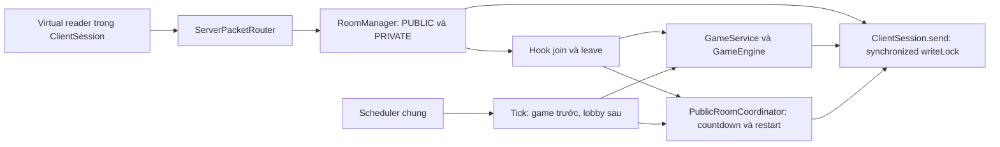

# Kế hoạch Skribbl Multiplayer — Java 21, JavaFX, chơi nhanh và phòng riêng

Cập nhật 11/11/2026 theo hướng nhóm đã chọn. **Đây là kế hoạch cần triển khai, không phải xác nhận mọi tính năng đã có trong source.** Lần cập nhật này chỉ sửa Markdown; giữ nguyên Java/POM và bài bạn đang tự viết. Không sửa INSTRUCTION.md.

## 1. Mục tiêu và công nghệ thống nhất

Xây game desktop nhiều người chơi qua TCP: có thể bấm **Chơi nhanh** để server ghép người lạ, hoặc **Chơi với bạn** bằng mã phòng. Dùng chung luật vẽ/đoán, điểm và canvas cho cả hai chế độ.

| Thành phần | Quyết định |
|---|---|
| Java | Java 21, Maven ba module common/server/client |
| Mạng | TCP Socket, UTF-8, NDJSON: mỗi packet một dòng kết thúc bằng `\n` |
| Client | JavaFX 21.0.13, UI dựng bằng Java; chưa dùng FXML |
| Đồ họa | Canvas/GraphicsContext, 12 màu, cỡ nét, tẩy, clear; hệ tọa độ logic 960×600 |
| Đa luồng server | Tận dụng `TcpServer` & `ClientSession` (Java 21 Virtual Thread đọc kết nối); đồng bộ state theo từng phòng (`roomLock`) và `RoomManager`; một scheduler tick chung |
| Gửi socket | Mỗi `ClientSession` gửi trực tiếp an toàn đa luồng qua `synchronized (writeLock)` kèm `newLine()` + `flush()` |
| UI thread | Worker đọc/ghi TCP; Platform.runLater áp dụng DTO lên JavaFX Application Thread |
| Dữ liệu | Phòng/điểm trên RAM, từ tiếng Anh từ words_en.csv; chưa có tài khoản/database |
| Đóng gói | Server JAR chứa dependency; client nạp JavaFX runtime đúng OS/CPU theo PFX |
| Kiểm thử | JUnit 5, fake clock cho thời gian, socket thật cho protocol, demo nhiều client/LAN |

TCP_NODELAY giảm một nguồn chờ gom các gói nhỏ, không bảo đảm độ trễ bằng 0. Đồng bộ theo từng phòng (`roomLock`) và `synchronized (writeLock)` ở `ClientSession` giữ nguyên lõi mạng TV1 đã hoàn thiện, đồng thời giúp các phòng chạy độc lập không làm nghẽn nhau như một vòng lặp đơn luồng toàn cục. Đây là thiết kế vừa sức đồ án, không khẳng định đã đạt tải production.

## 2. Hai chế độ chơi bắt buộc trong bản chính

| Thuộc tính | Chơi nhanh: PUBLIC | Chơi với bạn: PRIVATE |
|---|---|---|
| Vào phòng | Bấm Chơi nhanh, server tự chọn/tạo phòng chờ | Tạo phòng lấy mã 5 ký tự hoặc nhập mã bạn gửi |
| Ai tạo phòng | Server tự tạo khi cần | Người chơi chủ động tạo |
| Host | Không có quyền host; hostId=null, isHost=false | Người tạo là host, chuyển host khi người đó rời |
| Cấu hình | Cố định 3 vòng, 60 giây/lượt | Host chọn 1–10 vòng, 15–180 giây/lượt |
| Sức chứa | 6 người | 6 người |
| Bắt đầu | Đủ ít nhất 2 người, server đếm ngược 5 giây | Host bấm Start khi có ít nhất 2 người |
| Khi đang chơi | Không nhận người mới từ Chơi nhanh | Có thể nhập mã vào xem; quyền đoán theo luật vào muộn |
| Kết thúc ván | Giữ kết quả 5 giây → WAITING → nếu đủ người đếm ngược 5 giây ván mới | Giữ GAME_OVER, host bấm Chơi lại để start ván mới |
| Hủy chờ | Rời phòng, vẫn giữ kết nối server | Rời phòng, vẫn giữ kết nối server |

“Ngẫu nhiên” ở đây nghĩa ghép với người khác trong cùng server, **không phải** xếp hạng theo kỹ năng hoặc ghép qua nhiều máy chủ. Để ghép nhanh và không tạo nhiều phòng một người, server ưu tiên phòng PUBLIC WAITING đông nhất; hòa thì chọn phòng tạo trước. Không cần hàng đợi matchmaking tách riêng.

### 2.1. Chơi nhanh đi như thế nào?

```text
Kết nối và nhận CONNECT_ACK
→ Chơi nhanh → QUICK_JOIN
→ Server lọc phòng PUBLIC / WAITING / còn chỗ / nickname không trùng
→ Chọn phòng đông nhất, hòa chọn phòng cũ nhất; không có thì tạo mới
→ Thêm thành viên → ROOM_UPDATE
→ Một người: hiển thị “Đang chờ thêm người”
→ Từ hai người: đếm ngược 5 giây
→ Hết hạn và vẫn đủ người: bắt đầu ván một lần
→ GameEngine chạy luật vẽ/đoán chung
```

Người thứ ba vào không reset countdown; phòng đủ 6 cũng không bỏ qua countdown. Tụt xuống một người thì hủy countdown, trở về chờ. Có người mới sau đó thì tạo countdown 5 giây mới. Phòng đang DRAWING/WORD_SELECTION/REVEAL/GAME_OVER không là ứng viên QUICK_JOIN.

Mọi quyết định ghép phòng, đếm số người và bắt đầu ván mới được đồng bộ nhất quán qua `RoomManager`, khóa từng phòng (`roomLock`) và `PublicRoomCoordinator`. Không fake một người làm host để khởi động phòng PUBLIC.

### 2.2. Phòng riêng đi như thế nào?

```text
Tạo phòng riêng → CREATE_ROOM → nhận roomCode 5 ký tự
→ Sao chép mã gửi bạn bè
→ Bạn nhập mã → JOIN_ROOM
→ ROOM_UPDATE hiển thị thành viên/host
→ Host bấm START_GAME
→ GameEngine chạy luật vẽ/đoán chung
```

JOIN_ROOM chỉ nhận mã phòng PRIVATE. Phòng PUBLIC vẫn có ID nội bộ phục vụ định tuyến/log nhưng không hiển thị mã để mời. Room code là mã tham gia, không phải cơ chế xác thực tài khoản/mật khẩu.

### 2.3. Các trường hợp rời và gửi lặp

- QUICK_JOIN lặp khi đã ở PUBLIC: gửi lại snapshot hiện tại, không đổi phòng/reset countdown/thêm membership.
- QUICK_JOIN khi ở PRIVATE: từ chối, yêu cầu rời trước. Không tự làm người chơi mất phòng riêng.
- JOIN_ROOM lặp vào đúng phòng hiện tại: trả snapshot, không remove/add lại.
- Đổi phòng riêng: kiểm tra phòng đích, loại phòng, sức chứa, nickname trước khi rời phòng cũ.
- Client chưa CONNECT_ACK không được tạo/join/quick join.
- Mọi đường leave/EOF/chuyển phòng dùng hook RoomManager chung. Dưới 2 người khi đang chơi thì hủy ván về WAITING theo engine; PUBLIC đợi người mới, PRIVATE đợi host Start.
- Phòng rỗng: xóa room, engine, history canvas và dữ liệu countdown/restart.

## 3. Luật game thống nhất với hướng dẫn TV2

Các con số dưới đây thay thế công thức cũ của PLAN; không áp dụng lẫn hai bộ luật.

| Nội dung | Quy tắc |
|---|---|
| Ván/vòng/lượt | Một vòng: mỗi ID chụp đầu vòng có tối đa một lượt vẽ; hết queue mới tăng vòng |
| Thứ tự vẽ | Sort ID của snapshot đầu vòng để ổn định; chưa thêm thứ tự ngẫu nhiên riêng |
| Chọn từ | Unicast 3 từ cho drawer, 10 giây; hết giờ tự chọn index 0 |
| Chọn từ cũ | CHOOSE_WORD mang turnId, index 0..2; sai lượt/người/state thì từ chối |
| Gợi ý | Mốc 50%/75% thời gian đã qua; tối đa 2 chữ và không quá một nửa số chữ, giữ khoảng trắng |
| Đáp án | Chuẩn hóa khoảng trắng/chữ thường, kiểm tra trên server |
| Gần đúng | Levenshtein=1 chỉ báo riêng, không cộng điểm |
| Điểm đoán | `100 + 400 * remainingSec / drawTimeSec`, chia nguyên; server từ chối khi đã hết hạn |
| Điểm drawer | +50 cho mỗi người đoán đúng; không có bonus người đoán đầu tiên |
| Chống cộng trùng | Mỗi ID một lần/lượt; tổng điểm và turnScores là hai dữ liệu khác nhau |
| Kết thúc lượt | Hết hạn, tất cả eligible đúng hoặc drawer rời khi vẫn đủ người |
| Reveal | 3 giây, TURN_END công bố đáp án; nếu chưa chọn từ thì word rỗng |
| Vào muộn PRIVATE | Xem/chat/sync hình, chưa đoán lấy điểm lượt hiện tại; lượt kế tiếp được đoán, vòng kế tiếp vào queue vẽ |
| Hòa điểm | GAME_OVER chứa tất cả người đạt điểm cao nhất |
| Chơi lại | Reset tổng điểm/flags/canvas khi ván mới thực sự bắt đầu, không reset ngay lúc người dùng đóng kết quả |

Không broadcast text đoán đúng/gần đúng khi đang vẽ. Drawer và người đã đoán đúng chỉ nhận nhắc riêng khi cố chat trong lượt. Người biết đáp án có thể tiết lộ ngoài app, nên đây là kiểm soát protocol/chat, không hứa ngăn mọi hình thức gian lận.

## 4. Giao thức và cấu trúc bổ sung

### 4.1. Thay đổi tối thiểu

- Thêm RoomType: PUBLIC và PRIVATE.
- CREATE_ROOM vẫn tạo PRIVATE; JOIN_ROOM vẫn nhập mã PRIVATE. Payload cấu hình hiện có giữ nguyên.
- Thêm QUICK_JOIN, payload rỗng. Không cần MATCH_FOUND hoặc CANCEL_MATCH: membership và LEAVE_ROOM đã diễn đạt đủ.
- ROOM_UPDATE thêm roomType, maxPlayers và Integer startInSec. startInSec=null khi không countdown; PRIVATE luôn null. PUBLIC WAITING có countdown thì giá trị 5..0 theo server.
- PUBLIC hostId=null, mọi PlayerDto.isHost=false. PRIVATE giữ cơ chế host.
- `ROOM_UPDATE` luôn chỉ dùng cho trạng thái của một phòng hợp lệ đang tồn tại (`roomCode != null`, `roomType != null`), không gửi `ROOM_UPDATE` chứa các trường `null` khi rời phòng. Sau `LEAVE_ROOM` chủ động, server gửi lại gói `LEAVE_ROOM` (payload rỗng, đóng vai trò ACK xác nhận rời phòng) cho riêng sender để client mở lại controls và chuyển về màn hình sảnh chính. Disconnect/EOF không cố gửi ACK.
- Các packet WORD_CHOICES/CHOOSE_WORD, TURN_START/TIMER_UPDATE, chat/score và canvas tiếp tục dùng chung hai mode.
- P10 thêm TurnStartDto.canGuess để UI phân biệt người được đoán và spectator mà không parse nội dung chat SYSTEM; phía server vẫn là nơi xác thực quyền.

Đây là thay đổi common phải build đồng bộ client/server. Code mẫu P00–P08 là nền phòng riêng; P09 là patch bắt buộc hoàn thiện hai mode, có hướng dẫn sửa constructor và các guard host. Không coi bản chỉ có P08 là đã hoàn thành kế hoạch mới.

### 4.2. Luồng và ownership



Kế thừa trực tiếp `TcpServer` và `ClientSession` đã hoàn thiện của TV1: mỗi kết nối đọc trên một Virtual Thread và gửi trực tiếp an toàn qua `synchronized (writeLock)`. `PublicRoomCoordinator` giữ deadline countdown/restart, không giữ bản sao membership riêng. `GameEngine` giữ state và luật ván. Các thao tác thay đổi membership và trạng thái ván được đồng bộ theo khóa cấp phòng (`roomLock`) để các phòng hoạt động độc lập, không chặn lẫn nhau. Thời gian lấy từ `Clock` (`nanoTime`) để test bằng clock giả; không `sleep` để chờ countdown.

PRIVATE bắt đầu từ onStart(sender) xác thực host. PUBLIC bắt đầu từ API nội bộ startPublicGame() xác thực roomType/state/số người và dùng chung bước reset/start; client gửi START_GAME vào PUBLIC bị từ chối. Sau GAME_OVER PUBLIC: coordinator chờ 5 giây, chuyển về WAITING và hẹn 5 giây nếu còn đủ người.

## 5. Cải tiến bản chính và backlog nâng cao

### 5.1. Bản chính bắt buộc, vừa sức nhóm ba người

| Cải tiến | Cách làm giới hạn phạm vi | Phụ trách |
|---|---|---|
| Sảnh có 3 lựa chọn | Chơi nhanh / Tạo phòng riêng / Nhập mã; không thêm danh sách phòng toàn server | TV2 + TV3 |
| Sao chép mã | Clipboard JavaFX, chỉ PRIVATE; báo đã sao chép | TV2 |
| Chờ/countdown có phản hồi | Hiện số người/6, thông báo đang chờ, số giây do server gửi và nút rời | TV2 + TV1 |
| Trạng thái kết nối | Đang kết nối, lỗi, mất mạng và retry; không tự reconnect giữ slot | TV3 |
| Điểm/kết quả/chơi lại | Bảng điểm và hòa hạng đúng snapshot; PRIVATE host start, PUBLIC tự chu kỳ | TV2 + TV3 |
| Hạn chế từ lặp | Mỗi engine ưu tiên từ chưa chọn trong ván; còn dưới 3 từ phù hợp thì cho phép tái sử dụng | TV2 |
| Chống spam | Tối đa 5 CHAT_SEND hợp lệ nội dung/người/5 giây, bao gồm guess; quá giới hạn không xử lý và báo riêng tối đa một lần/window | TV2 |
| Chỉ dẫn vai trò | Bạn đang vẽ / đang đoán / vào muộn chờ lượt / đã đoán đúng | TV2 + TV3 |

Không lấy thời gian từ Timeline/AnimationTimer để quyết định điểm hoặc auto-start. UI chỉ hiển thị. Thông báo lỗi không làm người dùng hiểu rằng đã vào phòng khi server chưa chấp nhận.

### 5.2. Backlog chỉ làm khi bản chính đã qua test

| Ưu tiên | Tính năng | Giá trị và phụ thuộc | Phụ trách |
|---|---|---|---|
| A1 | Âm thanh có bật/tắt, CSS, hiệu ứng kết quả | Cải thiện cảm giác chơi, không cần đổi protocol; tùy chọn cục bộ | TV2 + TV3 |
| A2 | Undo một lần kéo chuột | Cần strokeId/nhóm nét, lịch sử server và redraw client; không xóa tùy tiện một đoạn DRAW_STROKE | TV3 + TV1 |
| A3 | Công cụ hình học, đổ màu | Cần thống nhất thao tác/pixel/history để mọi client cùng kết quả; khó hơn toolbar đơn giản | TV3 |
| A4 | Reconnect giữ chỗ 30 giây | Cần session token, timeout slot, khôi phục phase/time/history và ngăn session cũ tiếp tục gửi | TV1 + TV2 + TV3 |

Chỉ mở một mục nâng cao mỗi lần, sau khi bản chính build/test/LAN demo thành công. Trước A2–A4 phải có patch thiết kế riêng, không tự thêm type packet rải rác vào bản chính. Tài khoản, database, xếp hạng dài hạn và nhiều matchmaking server không thuộc bản hiện tại.

## 6. Phân công để tránh trùng việc

| Thành viên | Sở hữu | Điểm phối hợp |
|---|---|---|
| TV1 | TCP (`TcpServer`), `ClientSession` (Virtual Thread reader + `synchronized` writer), `ServerPacketRouter`, `RoomManager`/`GameRoom`, mode/capacity/code, chọn phòng công khai, build | Common DTO thay cùng TV2; hook membership đồng bộ an toàn với coordinator và game engine |
| TV2 | GameEngine, Score/Words, TurnScheduler, PublicRoomCoordinator, countdown/restart, chat/guess/rate limit, Lobby/Chat/Score/Result UI | TV1 đưa membership; TV3 thực hiện ClientActions, điều hướng và FX dispatch |
| TV3 | SocketClient/reader/writer, ClientController, Stage/Scene, Canvas/GraphicsContext, toolbar/throttler, CanvasSyncService, top bar/word choice | Dùng snapshot TV2, đồng bộ history; không tạo engine hoặc clock điểm ở client |

Phân công là theo chức năng; khi sửa common và hook file của người khác cần thống nhất một API, không tạo class trùng tên. Không khẳng định dùng chung package là sẽ không bao giờ có merge conflict.

## 7. Thứ tự patch để tự viết và giao Antigravity

| Patch | Sản phẩm | Điều kiện nghiệm thu |
|---|---|---|
| P00 | Luật và giao thức thống nhất | Phân biệt hai mode, ván/vòng/lượt, host và auto-start |
| P01 | Từ, mask, Levenshtein, điểm, CSV | Test hàm thuần; chưa cần JavaFX |
| P02 | Clock, scheduler chung và đồng bộ cấp phòng | Tận dụng `TcpServer`/`ClientSession` sẵn có của TV1; tick định kỳ và cleanup đúng khóa phòng |
| P03–P04 | Game engine và guess | Chơi được bằng test/packet; private baseline trước |
| P05 | Hook server và vòng đời phòng | Leave/EOF/chuyển phòng cùng đường cleanup |
| PFX | JavaFX runtime/build/lifecycle | Khung Application/Stage chạy, biết cách chạy JAR với SDK |
| P06–P08 | UI private baseline và tích hợp | Ván private hoàn chỉnh, không block FX thread |
| [P09](tv2/09-patch-phong-cong-khai-va-rieng.md) | Hai mode + QUICK_JOIN + countdown/restart | Chơi nhanh không cần host; riêng có mã và đúng quyền |
| [P10](tv2/10-patch-cai-tien-trai-nghiem.md) | Copy mã, UX, từ ít lặp, rate limit | Trải nghiệm hoàn chỉnh, test không lẫn state |
| Nâng cao | Chọn A1 rồi cân nhắc A2–A4 | Chỉ sau khi toàn bộ bản chính đạt nghiệm thu |

P09/P10 là bản chính, không phải stretch goal. Người đang viết P03 tiếp tục làm nền; đọc P09 trước để biết phần start sẽ tách và không viết giả định “mọi room đều có host” vào chỗ mới. Hợp đồng P09 có ưu tiên cao hơn ví dụ nền khi áp dụng mở rộng.

Mỗi patch Markdown phải có: file phối hợp, code mẫu hoặc thay đổi cần làm, ai gọi method, thread chạy, đầu vào/đầu ra, dữ liệu thay đổi, lỗi/return sớm, tình huống A/B/C và cách test. Chỉ triển khai vào source khi người học yêu cầu, không tự đánh dấu hoàn tất từ việc có tài liệu.

## 8. Test plan bắt buộc

### Ghép và điều phối

- Một QUICK_JOIN tạo PUBLIC WAITING; một người chưa có countdown.
- Người thứ hai bắt đầu 5 giây; người thứ ba không reset; hết hạn start đúng một lần.
- Leave/EOF làm còn một người thì cancel; người mới vào tạo countdown mới.
- Đủ 6 không nhận người thứ bảy; hai yêu cầu đồng thời không chiếm cùng slot cuối.
- Không ghép vào PRIVATE hay PUBLIC đang chơi/GAME_OVER; nickname trùng thì chọn phòng phù hợp khác hoặc tạo mới.
- QUICK_JOIN lặp không đổi membership/countdown; QUICK_JOIN khi PRIVATE không tự rời phòng.
- PUBLIC từ chối START_GAME và JOIN_ROOM bằng mã, không cần/không hiển thị host.
- PRIVATE vẫn tạo/join/copy mã, host Start, đổi host và chơi lại như trước.
- GAME_OVER PUBLIC chờ kết quả 5 giây → WAITING → countdown 5 giây → reset/start mới; thiếu người thì đợi.
- Phòng rỗng dọn room/engine/history/deadline; callback muộn không làm sống lại phòng.

### Luật và trải nghiệm

- Hai mode cùng chơi không lẫn từ, score, timer, history hoặc packet.
- Word choice gửi riêng, đáp án/gần đúng không lộ qua chat, điểm chỉ cộng một lần.
- Deadline kiểm tra cả khi tick chưa đến; drawer rời/thiếu người xử lý đúng.
- Từ đã chọn được ưu tiên tránh lặp trong ván, hết pool không treo; phòng khác độc lập.
- Giới hạn chat đúng 5/5 giây, hết window gửi lại được, không spam warning và không chặn người khác.
- Copy mã chỉ PRIVATE; ack/ERROR/mất mạng mở lại controls; callback phiên cũ bị bỏ.
- Fake clock cho mốc 5/3/10/60 giây; socket thật xác minh unicast/broadcast; nhiều client thật xác minh FX/canvas.

### Build và demo

Từ repo root:

```powershell
mvn -f source/pom.xml clean test
mvn -f source/pom.xml package
```

Chạy server JAR, client JavaFX bằng Maven hoặc module path theo [PFX](tv2/05a-patch-javafx-setup.md). Không coi hai client JAR là tự chạy được nếu chưa có JavaFX runtime. Demo ít nhất: tạo/join phòng riêng bằng mã, hai người Chơi nhanh tự start, hủy countdown khi leave, đoán gần/đúng, drawer disconnect và chơi tiếp sau kết quả.

## 9. Quản lý tiến độ, Git và bằng chứng

- Checklist trên là tiêu chí cần làm; chỉ tick khi đã có test/log/ảnh tương ứng, không kế thừa trạng thái pass từ bản host-only.
- README gốc và README module ghi đúng tính năng đã triển khai, cách chạy và hạn chế. Báo cáo/sơ đồ được cập nhật sau khi có bằng chứng mới.
- Giữ nguyên thông tin thành viên và INSTRUCTION.md; không tự điền thông tin chưa biết.
- Commit theo patch nhỏ, ví dụ `feat(room): add public quick join and private room modes`, `feat(game): add automatic public room countdown`, `feat(lobby): add quick play and copy room code`.
- Không bắt buộc tạo nhiều commit cho đủ số lượng; lịch sử cần thể hiện đóng góp có ý nghĩa. Mỗi thành viên review phần ghép của người khác.
- Nhánh nâng cao tách khỏi bản đã demo ổn định; chưa merge nếu làm hỏng protocol hoặc lifecycle bản chính.
