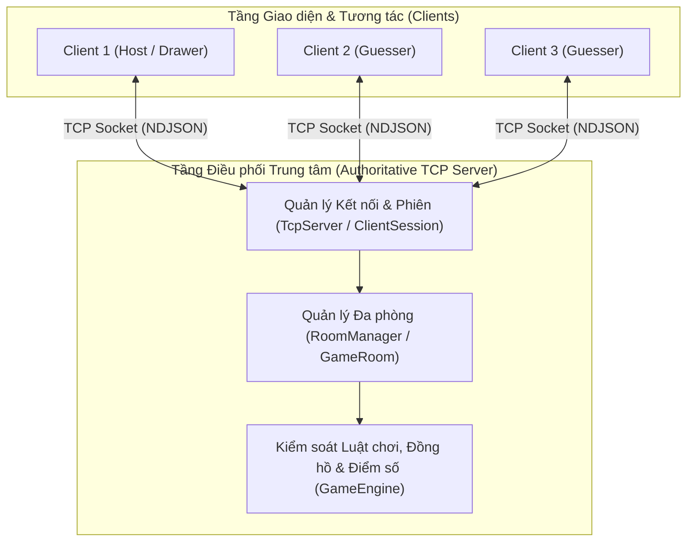
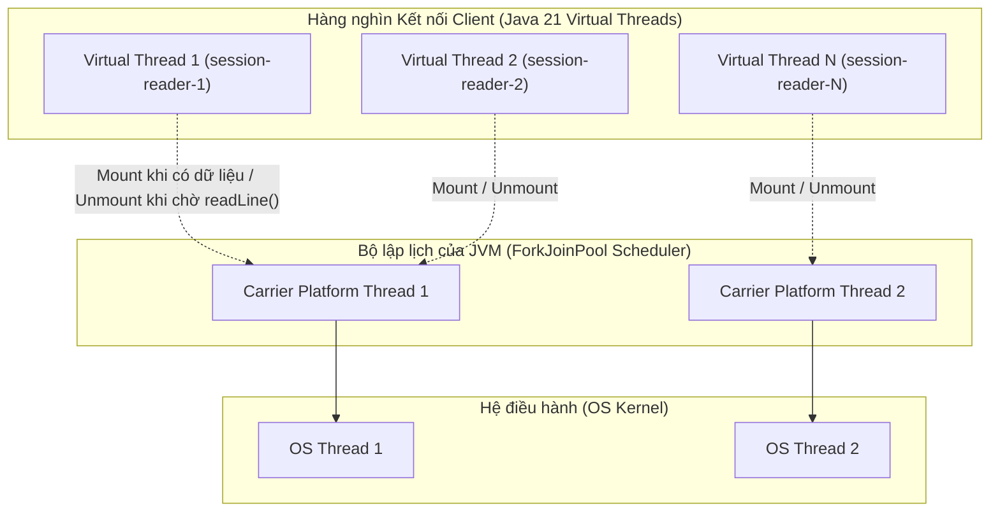
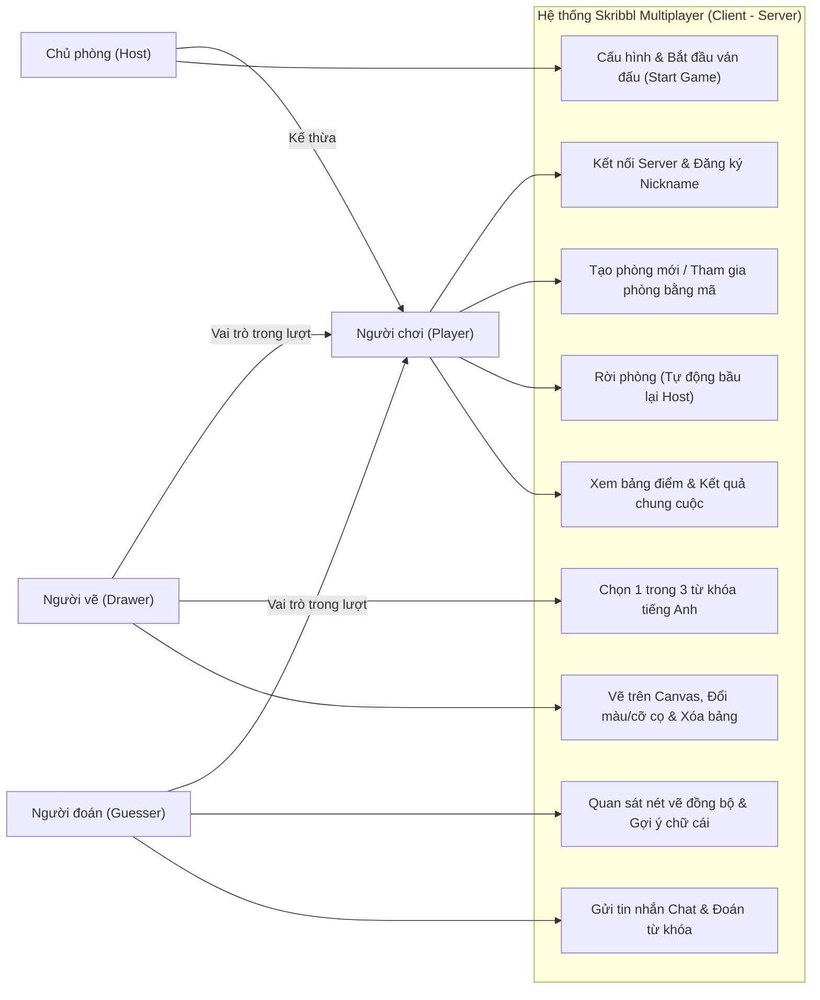
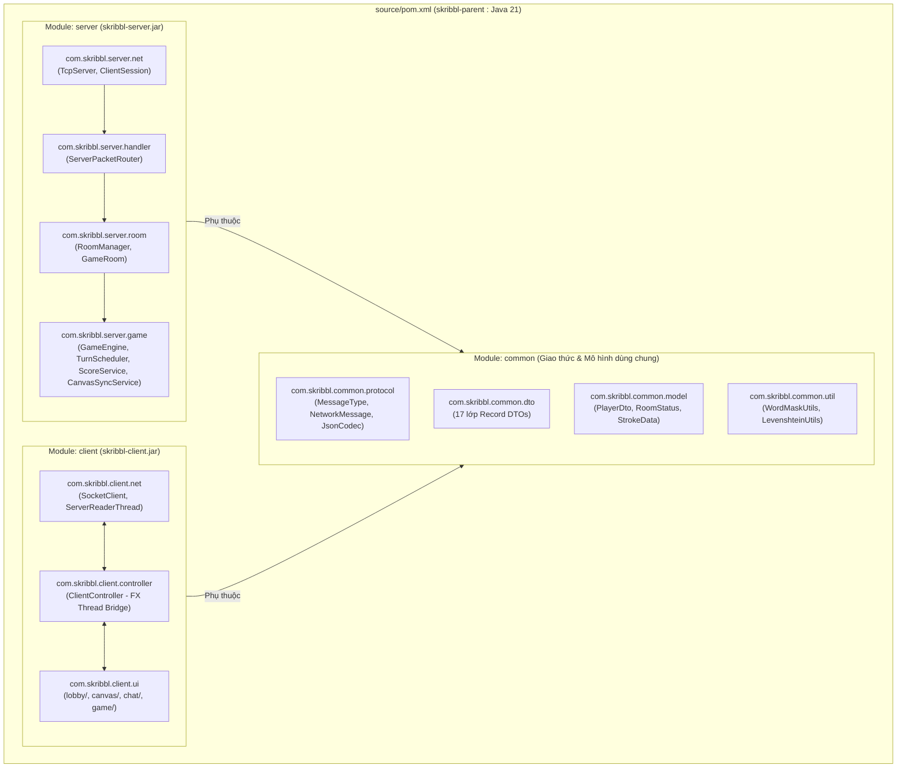
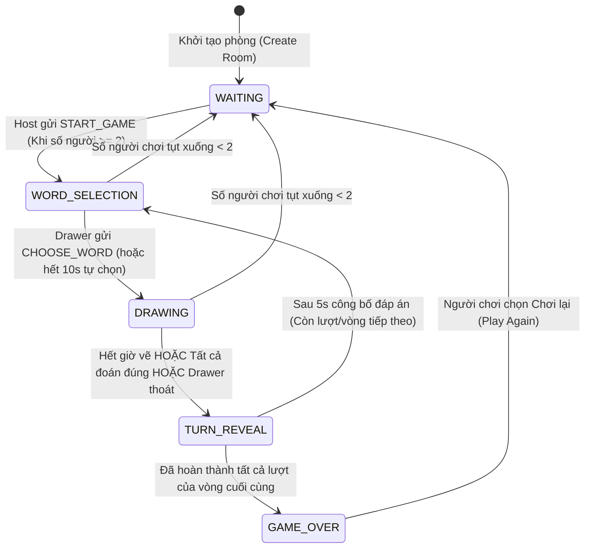
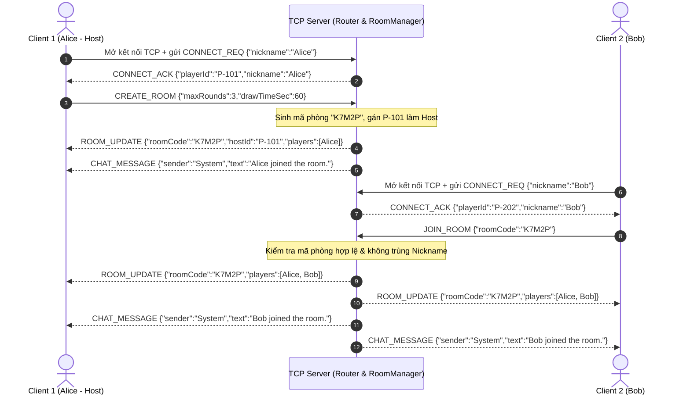
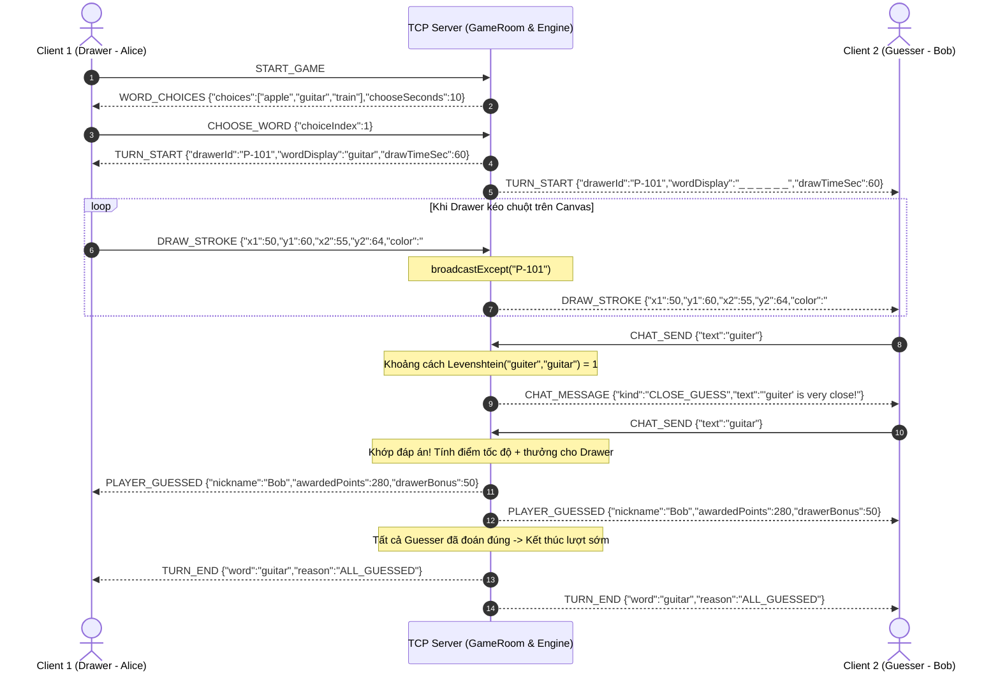

# BÁO CÁO TIỂU LUẬN MÔN LẬP TRÌNH MẠNG

> **Cập nhật thiết kế 11/11/2026:** Giao diện được chuyển sang JavaFX 21.0.13 theo [PFX](tv2/05a-patch-javafx-setup.md). Các đoạn UI trong báo cáo mô tả thiết kế sau chuyển đổi; POM/ClientMain nguồn chưa được sửa trong lần cập nhật Markdown này. Kết quả/log kiểm thử cũ không chứng minh client JavaFX đã chạy; cần bổ sung bằng chứng mới khi triển khai P08.

**HỌC VIỆN CÔNG NGHỆ BƯU CHÍNH VIỄN THÔNG**  
**KHOA CÔNG NGHỆ THÔNG TIN 1**  

---

## ĐỀ TÀI:
# XÂY DỰNG ỨNG DỤNG TRÒ CHƠI VẼ VÀ ĐOÁN CHỮ TRỰC TUYẾN NHIỀU NGƯỜI CHƠI (SKRIBBL CLONE) THEO MÔ HÌNH CLIENT–SERVER SỬ DỤNG TCP SOCKET VÀ ĐA LUỒNG TRONG JAVA 21

**Giảng viên hướng dẫn:** Nguyễn Quốc Huy
**Nhóm thực hiện:** Nhóm 20 – Lập trình mạng  

| STT | Họ và Tên | Mã sinh viên | Email | Phần việc phụ trách chính |
| :-: | :--- | :---: | :--- | :--- |
| 1 | **Trần Hán Nam** | B23DCCN590 | namth.b23dccn590@stu.ptit.edu.vn | Hạ tầng TCP Server, Đa luồng Java 21 Virtual Threads, Giao thức NDJSON (`common`) & Hệ thống Đa phòng (`RoomManager`, `GameRoom`) |
| 2 | **Đàm Tiến Thành** | B23DCCN764 | thanhtd.b23dccn764@stu.ptit.edu.vn | Máy trạng thái Luật chơi (`GameEngine`), Bộ đếm thời gian (`TurnScheduler`), Kiểm tra từ khóa, Tính điểm & Giao diện Lobby / Chat |
| 3 | **Đinh Minh Tuân** | B23DCCN880 | tuandm.b23dccn880@stu.ptit.edu.vn | Tầng mạng Client (`SocketClient`), điều phối JavaFX Application Thread, Canvas/GraphicsContext & Đồng bộ nét vẽ (`CanvasSync`) |

*Hà Nội, tháng 11 năm 2026*

---

## MỤC LỤC

- **LỜI NÓI ĐẦU**
- **CHƯƠNG 1: ĐẶT VẤN ĐỀ**
  - 1.1. Giới thiệu trò chơi và lý do lựa chọn đề tài
  - 1.2. Mục tiêu và phạm vi của đề tài
  - 1.3. Bảng phân chia công việc
- **CHƯƠNG 2: CƠ SỞ LÝ THUYẾT VÀ CÔNG NGHỆ SỬ DỤNG**
  - 2.1. Tổng quan về Lập trình mạng và Mô hình Client–Server
  - 2.2. Giao thức TCP/IP và Lập trình TCP Socket trong Java (`java.net`)
  - 2.3. Kỹ thuật Đa luồng (Multithreading) và Java 21 Virtual Threads
  - 2.4. Thiết kế Giao thức Tầng Ứng dụng với NDJSON và Thư viện Jackson
  - 2.5. Lập trình Giao diện Đồ họa với JavaFX, Canvas và Mô hình MVC
- **CHƯƠNG 3: PHÂN TÍCH VÀ THIẾT KẾ HỆ THỐNG**
  - 3.1. Phân tích yêu cầu hệ thống (Chức năng & Phi chức năng)
  - 3.2. Sơ đồ Use Case và Phân tích Tác nhân
  - 3.3. Thiết kế Kiến trúc Tổng thể Hệ thống (Maven Multi-module)
  - 3.4. Thiết kế Máy trạng thái Phòng chơi (`RoomStatus` State Machine)
  - 3.5. Thiết kế Giao thức Trao đổi Dữ liệu Giữa Client và Server (NDJSON Protocol)
  - 3.6. Sơ đồ Tuần tự (Sequence Diagrams) cho các Luồng Nghiệp vụ Chính
  - 3.7. Thiết kế Tổ chức Dữ liệu In-Memory và Kho Từ vựng (`words_en.csv`)
- **CHƯƠNG 4: CÀI ĐẶT, TRIỂN KHAI VÀ KIỂM THỬ CHƯƠNG TRÌNH**
  - 4.1. Môi trường Phát triển và Cấu hình Dự án Maven Multi-module
  - 4.2. Cài đặt Module `common` – Đóng gói Bản tin và Giao thức NDJSON
  - 4.3. Cài đặt Module `server` – Lõi TCP Đa luồng, Quản lý Phiên và Đa phòng
  - 4.4. Cài đặt Nghiệp vụ Trò chơi, Đồng bộ Nét vẽ và Giao diện `client`
  - 4.5. Kiểm thử Tự động (Unit Test & TCP Integration Test với JUnit 5)
  - 4.6. Kết quả Thực nghiệm và Minh họa Giao diện Chương trình
- **CHƯƠNG 5: ĐÁNH GIÁ, KẾT LUẬN VÀ HƯỚNG PHÁT TRIỂN**
  - 5.1. Đánh giá Kết quả Đạt được
  - 5.2. Ưu điểm và Hạn chế của Hệ thống
  - 5.3. Hướng Phát triển Mở rộng trong Tương lai
- **PHỤ LỤC: TỔNG HỢP KIẾN THỨC TRỌNG TÂM PHỤC VỤ VẤN ĐÁP BẢO VỆ (50% ĐIỂM CÁ NHÂN)**
- **TÀI LIỆU THAM KHẢO**

---

## LỜI NÓI ĐẦU

Trong kỷ nguyên số hóa hiện nay, các hệ thống phân tán và ứng dụng truyền thông thời gian thực (Real-time Network Applications) đóng vai trò nền tảng trong hầu hết các lĩnh vực từ hội nghị truyền hình, cộng tác trực tuyến (collaborative whiteboard), nhắn tin tức thời cho đến trò chơi trực tuyến nhiều người chơi (multiplayer online games). Khác với các ứng dụng tra cứu dữ liệu tĩnh theo mô hình Request–Response đơn thuần, một hệ thống tương tác thời gian thực đòi hỏi sự phối hợp chặt chẽ giữa kỹ thuật quản lý kết nối mạng bền vững, thiết kế giao thức truyền thông có độ trễ thấp, xử lý đồng thời đa luồng (concurrency) và cơ chế chịu lỗi khi mạng không ổn định.

Học phần **Lập trình mạng** cung cấp cho sinh viên những kiến thức cốt lõi về cách các tiến trình trên các máy tính khác nhau trao đổi dữ liệu qua mạng máy tính thông qua giao diện lập trình Socket (TCP/UDP), quản lý luồng I/O, đa luồng và xây dựng giao thức tầng ứng dụng. Để vận dụng toàn diện các kiến thức lý thuyết đó vào thực tiễn, nhóm chúng em đã lựa chọn đề tài: ***"Xây dựng ứng dụng trò chơi vẽ và đoán chữ trực tuyến nhiều người chơi (Skribbl Clone) theo mô hình Client–Server sử dụng TCP Socket và Đa luồng trong Java 21"***.

Thông qua việc tự thiết kế giao thức truyền thông điệp **NDJSON (Newline-Delimited JSON)** chạy trên **TCP Socket thuần (`java.net.ServerSocket`, `Socket`)**, kết hợp **Java 21 Virtual Threads** phía Server và thiết kế **JavaFX / Canvas** phía Client, đề tài minh họa vòng đời ứng dụng mạng: định danh, quản lý đa phòng, truyền tọa độ nét vẽ, đồng bộ thời gian và xử lý mất kết nối.

Nhóm xin gửi lời cảm ơn chân thành tới giảng viên **Nguyễn Quốc Huy** đã tận tình giảng dạy và định hướng chuyên môn để nhóm hoàn thành tiểu luận này.

---

# CHƯƠNG 1: ĐẶT VẤN ĐỀ

## 1.1. Giới thiệu trò chơi và lý do lựa chọn đề tài

### Giới thiệu trò chơi (Skribbl Clone)
**Skribbl Clone** là ứng dụng trò chơi vẽ và đoán từ khóa trực tuyến nhiều người chơi (*Multiplayer Drawing & Guessing Game*) hoạt động theo mô hình **Client–Server** qua mạng LAN hoặc Internet:
- Người chơi sử dụng ứng dụng Desktop kết nối tới Server, đăng ký tên hiển thị (*Nickname*), sau đó tạo phòng chơi mới (với mã phòng 5 ký tự) hoặc nhập mã để tham gia phòng có sẵn.
- Một ván đấu gồm nhiều vòng (*Rounds*). Trong mỗi lượt (*Turn*), hệ thống chọn luân phiên một thành viên làm **Người vẽ (*Drawer*)** và những người còn lại làm **Người đoán (*Guessers*)**.
- Người vẽ chọn 1 trong 3 từ khóa tiếng Anh do Server cung cấp và sử dụng bảng vẽ đồ họa (`Canvas`) với các công cụ bút màu, kích thước nét, cục tẩy để minh họa từ khóa đó. Toàn bộ nét vẽ được truyền trực tiếp theo thời gian thực sang màn hình của tất cả Người đoán trong phòng.
- Trong thời gian đếm ngược của lượt vẽ, hệ thống mở dần các chữ cái gợi ý. Người đoán nhập đáp án vào khung Chat; ai đoán đúng càng sớm sẽ nhận được điểm thưởng càng cao, đồng thời Người vẽ cũng được cộng điểm thưởng. Kết thúc các vòng chơi, bảng xếp hạng sẽ vinh danh người chiến thắng chung cuộc.

### Lý do lựa chọn đề tài
Nhóm lựa chọn đề tài này cho tiểu luận môn **Lập trình mạng** vì 4 lý do cốt lõi sau:
1. **Tiêu biểu cho truyền thông song công thời gian thực (Full-Duplex Real-time):** Hệ thống không chỉ nhận yêu cầu đơn lẻ mà phải liên tục truyền phát đồng thời tọa độ nét vẽ, bộ đếm ngược từng giây, gợi ý từ khóa và tin nhắn chat tới nhiều máy trạm.
2. **Tự thiết kế Giao thức tầng ứng dụng trên nền TCP Socket thuần:** Sử dụng trực tiếp `ServerSocket` và `Socket` kết hợp định dạng **NDJSON (Newline-Delimited JSON)** giúp nhóm nắm vững kỹ thuật đóng khung bản tin (*Message Framing*), mã hóa `UTF-8` và tối ưu độ trễ mạng (`TCP_NODELAY`).
3. **Ứng dụng đa luồng và đồng bộ:** Server dùng Java 21 Virtual Threads và quản lý dữ liệu phòng; client chuyển DTO từ reader nền lên **JavaFX Application Thread**. Kế hoạch TV2 tách riêng hàng đợi xử lý trạng thái và writer của từng session.
4. **Giao diện kiểm chứng luồng mạng:** Thiết kế **JavaFX Controls + Canvas** phục vụ demo và kiểm tra các trường hợp người vẽ thoát, bầu lại Host, đồng bộ phòng và điểm.

## 1.2. Mục tiêu và phạm vi của đề tài

### Mục tiêu
- Xây dựng hoàn chỉnh hệ thống **Client–Server** gồm 3 module độc lập (`common`, `server`, `client`) bằng ngôn ngữ **Java 21 LTS** và công cụ quản lý dự án **Apache Maven**.
- Thiết kế và cài đặt bộ giao thức **NDJSON** gồm 22 loại bản tin (`MessageType`) đảm bảo tính nhất quán, dễ gỡ lỗi và mở rộng.
- Triển khai máy chủ TCP đa luồng sử dụng **Java 21 Virtual Threads**, hỗ trợ **nhiều phòng chơi hoạt động đồng thời** trên bộ nhớ RAM với đầy đủ cơ chế kiểm soát luật chơi, tính điểm tốc độ và đồng bộ nét vẽ thời gian thực.
- Đảm bảo khả năng chịu lỗi (*Fault Tolerance*): hệ thống không bị gián đoạn khi nhận gói tin sai định dạng hoặc khi người chơi/chủ phòng ngắt kết nối bất thường.

### Phạm vi
- **Tầng giao tiếp mạng:** Sử dụng giao thức **TCP Socket (`java.net`)**, triển khai chạy trên môi trường mạng nội bộ (LAN/Wi-Fi) hoặc Localhost.
- **Tầng lưu trữ dữ liệu:** Quản lý trạng thái các phiên kết nối và phòng chơi trực tiếp trên bộ nhớ khả biến (**In-Memory** thông qua `ConcurrentHashMap`) để tối ưu tốc độ phản hồi thời gian thực; kho từ vựng tiếng Anh được nạp từ tệp `statics/words_en.csv`.
- **Tầng giao diện người dùng:** Thiết kế ứng dụng desktop bằng **JavaFX 21.0.13**, UI dựng bằng Java và Canvas/GraphicsContext. Client JAR cần JavaFX runtime trên module path; native runtime/installer đóng gói riêng theo OS/CPU, không coi một JAR chạy độc lập trên mọi hệ điều hành.

## 1.3. Bảng phân chia công việc

Dự án được phân chia đồng đều cho 3 thành viên trong nhóm theo 3 trụ cột kỹ thuật độc lập, đảm bảo mỗi thành viên đều trực tiếp lập trình giao thức mạng, xử lý đa luồng và nắm vững toàn bộ luồng hoạt động của hệ thống:

| STT | Thành viên & MSSV | Module / Package phụ trách | Nội dung công việc chi tiết | Tỷ lệ đóng góp |
| :-: | :--- | :--- | :--- | :-: |
| 1 | **Trần Hán Nam**<br/>`B23DCCN590` | - `source/pom.xml`<br/>- `common.protocol.*`<br/>- `server.net.*`<br/>- `server.handler.*`<br/>- `server.room.*` | - Thiết kế cấu trúc gói tin `NetworkMessage`, `MessageType` và bộ mã hóa/giải mã `JsonCodec` (NDJSON UTF-8).<br/>- Xây dựng `TcpServer` (`ServerSocket`) và `ClientSession` ứng dụng **Java 21 Virtual Threads**, đồng bộ luồng ghi `synchronized(writeLock)`, `TCP_NODELAY`, xử lý `PING`/`PONG` và ngắt kết nối.<br/>- Xây dựng bộ định tuyến `ServerPacketRouter`, hệ thống đa phòng `RoomManager` & `GameRoom` (sinh mã phòng 5 ký tự, chặn trùng tên, tự động chuyển quyền Host).<br/>- Viết Unit Test & Integration Test mạng (`JsonCodecTest`, `RoomManagerTest`, `TcpServerIntegrationTest`). | **33.3%** |
| 2 | **Đàm Tiến Thành**<br/>`B23DCCN764` | - `common.util.*`<br/>- `statics/words_en.csv`<br/>- `server.game.*`<br/>- `client.ui.lobby.*`<br/>- `client.ui.chat.*` | - Xây dựng kho từ vựng tiếng Anh `WordRepository` (`words_en.csv`), tiện ích che từ khóa `WordMaskUtils` và tính khoảng cách chuỗi `LevenshteinUtils`.<br/>- Cài đặt máy trạng thái `GameEngine`, bộ đếm ngược phía Server `TurnScheduler` (`ScheduledExecutorService` 1s/tick, mở dần chữ cái gợi ý).<br/>- Xử lý nghiệp vụ kiểm tra đáp án qua mạng, báo *"Close guess!"*, chống lộ từ khóa và tính điểm tốc độ `ScoreService`.<br/>- Thiết kế giao diện `ConnectView`, `LobbyView`, khung `ChatGuessPanel`, bảng điểm `PlayerScorePanel` và màn hình tổng kết `GameOverDialog`. | **33.3%** |
| 3 | **Đinh Minh Tuân**<br/>`B23DCCN880` | - `client.net.*`<br/>- `client.controller.*`<br/>- `client.ui.canvas.*`<br/>- `client.ui.game.*`<br/>- `CanvasSyncService` | - Tầng mạng Client (`SocketClient`, `ServerReaderThread`) và `ClientController` chuyển cập nhật bằng `Platform.runLater` lên JavaFX Application Thread.<br/>- `DrawingCanvas` dùng Canvas/GraphicsContext, CanvasToolbar và StrokeThrottler; xử lý tọa độ logic, batch nét vẽ.<br/>- `CanvasSyncService` xác thực quyền và đồng bộ history; khung Stage/Scene, GameView và lifecycle Application. | **33.3%** |

---

# CHƯƠNG 2: CƠ SỞ LÝ THUYẾT VÀ CÔNG NGHỆ SỬ DỤNG

## 2.1. Tổng quan về Lập trình mạng và Mô hình Client–Server

### 2.1.1. Khái niệm Lập trình mạng
Lập trình mạng (Network Programming) là lĩnh vực kỹ thuật phần mềm tập trung vào việc viết các chương trình có khả năng giao tiếp và trao đổi dữ liệu với nhau qua hệ thống mạng máy tính (LAN hoặc WAN/Internet). Để hai tiến trình chạy trên hai máy vật lý khác nhau có thể hiểu và phối hợp hoạt động, chúng cần tuân thủ hai yếu tố:
1. **Mô hình kiến trúc kết nối** (xác định vai trò của từng nút mạng, phổ biến nhất là Client–Server và Peer-to-Peer).
2. **Giao thức truyền thông (Protocol)** ở cả tầng vận chuyển (TCP/UDP) và tầng ứng dụng (HTTP, WebSocket, hoặc giao thức tùy chỉnh như NDJSON trong đề tài này).

### 2.1.2. Mô hình Client–Server có thẩm quyền (Authoritative Client–Server Model)
Trong đề tài này, hệ thống được tổ chức theo mô hình **Client–Server tập trung**, trong đó Server nắm giữ quyền quyết định tối cao đối với trạng thái trò chơi (*Server-Authoritative Architecture*):



Ưu điểm vượt trội của mô hình *Server-Authoritative* trong ứng dụng trò chơi mạng bao gồm:
- **Đồng bộ nhất quán (Consistency):** Chỉ có một đồng hồ đếm ngược và một bảng điểm chuẩn duy nhất nằm trên Server, loại bỏ hoàn toàn tình trạng lệch giờ giữa các máy trạm.
- **Chống gian lận và bảo mật thông tin (Security & Anti-cheat):** Từ khóa bí mật chỉ được lưu trên Server và chỉ gửi riêng cho người vẽ. Khi người đoán gửi câu trả lời, Server kiểm tra trực tiếp thay vì để Client tự kiểm tra; tương tự, chỉ gói tin nét vẽ xuất phát từ đúng `currentDrawerId` mới được Server chấp nhận và chuyển tiếp.
- **Đơn giản hóa định tuyến mạng:** Các máy Client chỉ cần biết địa chỉ IP và cổng của Server mà không cần mở cổng (port forwarding) để kết nối trực tiếp với nhau.

## 2.2. Giao thức TCP/IP và Lập trình TCP Socket trong Java (`java.net`)

### 2.2.1. So sánh TCP và UDP đối với bài toán trò chơi vẽ & đoán chữ
Trong bộ giao thức TCP/IP, tầng vận chuyển (Transport Layer) cung cấp hai giao thức chính là **TCP (Transmission Control Protocol)** và **UDP (User Datagram Protocol)**:

| Tiêu chí | Giao thức TCP | Giao thức UDP | Lý do chọn TCP cho Skribbl Clone |
| :--- | :--- | :--- | :--- |
| **Đặc tính kết nối** | Hướng kết nối (*Connection-oriented*), bắt tay 3 bước (3-way handshake). | Không kết nối (*Connectionless*), gửi từng gói độc lập. | Cần duy trì phiên kết nối ổn định để quản lý trạng thái người chơi trong phòng. |
| **Độ tin cậy** | Đảm bảo dữ liệu đến đích đầy đủ, không lỗi bit, tự động truyền lại gói mất. | Không đảm bảo; gói tin có thể mất mà không thông báo. | Nếu mất gói `CLEAR_CANVAS`, `TURN_START` hoặc mất nét vẽ quan trọng, bức tranh ở máy người đoán sẽ bị sai lệch hoàn toàn. |
| **Thứ tự bản tin** | Bảo toàn tuyệt đối thứ tự gửi (*In-order delivery*). | Các gói tin có thể đến đích lộn xộn thứ tự. | Nét vẽ mới, lệnh tẩy và lệnh xóa bảng bắt buộc phải được thực thi theo đúng trình tự thời gian người vẽ thao tác. |
| **Phát hiện ngắt mạng** | Nhận biết ngay khi đầu bên kia đóng kết nối (`FIN`/`RST` -> `readLine() == null`). | Phải tự xây dựng hoàn toàn cơ chế timeout phức tạp. | Server cần phát hiện tức thì khi người đang vẽ thoát để chuyển lượt. |

### 2.2.2. Cơ chế hoạt động của `ServerSocket` và `Socket` trong gói `java.net`
Java cung cấp hai lớp cốt lõi trong gói `java.net` để lập trình TCP Socket:
- **`java.net.ServerSocket`:** Được khởi tạo trên Server và gắn (bind) vào một cổng lắng nghe xác định (ví dụ cổng `8888`). Phương thức `serverSocket.accept()` sẽ chặn (block) luồng gọi cho đến khi có một Client thực hiện bắt tay kết nối TCP thành công, sau đó trả về một đối tượng `Socket` đại diện riêng cho kết nối với Client đó.
- **`java.net.Socket`:** Đại diện cho một đầu cuối (endpoint) của kênh giao tiếp hai chiều giữa Client và Server. Từ đối tượng `Socket`, chương trình truy xuất hai luồng dữ liệu:
  - `socket.getInputStream()`: Luồng byte đầu vào để đọc dữ liệu từ phía bên kia gửi tới.
  - `socket.getOutputStream()`: Luồng byte đầu ra để gửi dữ liệu đi.

Trong hệ thống của nhóm, các luồng byte thô này được bọc qua `InputStreamReader` / `OutputStreamWriter` (với bảng mã `StandardCharsets.UTF_8`) và `BufferedReader` / `BufferedWriter` để tăng hiệu năng đọc/ghi theo dòng văn bản.

### 2.2.3. Tối ưu hóa độ trễ với `TCP_NODELAY` (Vô hiệu hóa thuật toán Nagle)
Mặc định, ngăn xếp mạng TCP áp dụng **thuật toán Nagle (RFC 896)**: khi ứng dụng gửi các mẩu dữ liệu có kích thước nhỏ (như một gói JSON tọa độ nét vẽ `DRAW_STROKE` chỉ dài khoảng 120 bytes), TCP có xu hướng giữ gói tin đó lại trong bộ đệm gửi cho đến khi nhận được gói `ACK` của gói trước đó hoặc gom đủ kích thước `MSS` (Maximum Segment Size). Kết quả là nét vẽ trên màn hình người đoán bị trễ từ `40ms` đến `200ms` và có cảm giác giật cục.

Bằng cách gọi `socket.setTcpNoDelay(true)` ngay khi khởi tạo kết nối ở cả Client và Server, hệ thống buộc tầng TCP đẩy ngay lập tức mỗi dòng JSON ra card mạng ngay sau lệnh `writer.flush()`, giúp độ trễ truyền nét vẽ trong mạng LAN giảm xuống dưới `2–5ms`.

## 2.3. Kỹ thuật Đa luồng (Multithreading) và Java 21 Virtual Threads

### 2.3.1. Bài toán xử lý đồng thời trên Server
Do các thao tác đọc dữ liệu từ Socket (`BufferedReader.readLine()`) và chờ kết nối mới (`ServerSocket.accept()`) là các thao tác **I/O chặn (Blocking I/O)**, một Server đơn luồng sẽ bị đóng băng hoàn toàn khi chờ dữ liệu từ Client đầu tiên và không thể phục vụ Client thứ hai. Vì vậy, Server bắt buộc phải sử dụng kiến trúc **Đa luồng (Multithreading)**.

### 2.3.2. Đột phá từ Java 21 Virtual Threads (Project Loom – JEP 444)
Trong các phiên bản Java trước đây, mỗi đối tượng `java.lang.Thread` là một **Platform Thread** ánh xạ 1–1 trực tiếp tới một luồng của hệ điều hành (OS Kernel Thread). Mỗi Platform Thread chiếm khoảng `1 MB` bộ nhớ Stack cố định và tốn nhiều chu kỳ CPU khi hệ điều hành chuyển ngữ cảnh (Context Switch).

Từ **Java 21 LTS**, nền tảng Java chính thức giới thiệu **Virtual Threads (Luồng ảo)**:



- **Cơ chế hoạt động:** Khi một Virtual Thread gọi `reader.readLine()` và chưa có dữ liệu từ mạng gửi tới, JVM tự động tháo (*unmount*) Virtual Thread đó ra khỏi luồng hệ điều hành (*Carrier Thread*), giải phóng CPU để phục vụ ngay cho Client khác. Ngay khi card mạng nhận được gói tin TCP mới, JVM gắn (*mount*) Virtual Thread trở lại để xử lý tiếp.
- **Lợi ích trong đề tài:** Cho phép giữ nguyên cách viết code đồng bộ tuần tự cực kỳ rõ ràng, dễ hiểu và dễ gỡ lỗi (`Thread.ofVirtual().name("session-reader-" + sessionId).start(...)`), nhưng lại đạt hiệu năng và khả năng mở rộng tương đương với lập trình bất đồng bộ Non-blocking I/O (Java NIO).

### 2.3.3. Các công cụ đồng bộ hóa đa luồng sử dụng trong hệ thống
- **`ConcurrentHashMap<K, V>`:** Lưu trữ danh sách phiên `sessions`, danh sách phòng `rooms` và danh sách người chơi trong từng phòng. Cấu trúc này cho phép nhiều luồng đọc đồng thời không khóa và chỉ khóa phân đoạn (bucket-level locking) khi ghi, tránh nghẽn cổ chai.
- **`AtomicBoolean`:** Quản lý cờ trạng thái đóng/mở của `TcpServer` (`running`) và `ClientSession` (`closed`) thông qua thao tác nguyên tử `compareAndSet(false, true)`, đảm bảo hàm `close()` chỉ thực thi đúng một lần duy nhất dù nhiều luồng cùng gặp lỗi mạng.
- **Khối `synchronized` (Intrinsic Lock):** Sử dụng `writeLock` trong `ClientSession` để tuần tự hóa các thao tác ghi ra Socket, và `roomLock` trong `GameRoom` để bảo vệ tính nguyên tử khi thêm/xóa người chơi và bầu chọn lại Chủ phòng.
- **`ScheduledExecutorService`:** Thực thi bộ đếm ngược chu kỳ `1 giây` phía Server để phát bản tin `TIMER_UPDATE` và mở chữ cái gợi ý.

## 2.4. Thiết kế Giao thức Tầng Ứng dụng với NDJSON và Thư viện Jackson

### 2.4.1. Tại sao cần định dạng NDJSON trên nền TCP?
Khác với UDP (gửi từng gói Datagram rời rạc), TCP chỉ cung cấp một ống dẫn byte liên tục. Giả sử Server gửi liên tiếp 2 bản tin JSON:
`{"type":"TIMER_UPDATE",...}` và `{"type":"CHAT_MESSAGE",...}`.
Khi đến bộ đệm đọc của Client, chúng có thể nằm sát nhau thành:
`{"type":"TIMER_UPDATE",...}{"type":"CHAT_MESSAGE",...}`.
Nếu truyền thẳng chuỗi đó vào bộ phân tích JSON thông thường, quá trình giải mã sẽ báo lỗi cú pháp.

**NDJSON (Newline-Delimited JSON)** giải quyết triệt để vấn đề này bằng hai quy ước đơn giản nhưng chặt chẽ:
1. Mỗi bản tin JSON hoàn chỉnh **không được chứa ký tự xuống dòng** (`\n` hoặc `\r`) bên trong cấu trúc định dạng của nó.
2. Cuối mỗi bản tin JSON được đánh dấu kết thúc bằng một ký tự xuống dòng `\n` (`writer.newLine()`).

Nhờ đó, đầu nhận chỉ cần gọi `BufferedReader.readLine()` là tách được chính xác từng bản tin nguyên vẹn 100%.

### 2.4.2. Thư viện Jackson Databind và Mô hình Envelope–Payload
Hệ thống sử dụng thư viện **Jackson (`com.fasterxml.jackson.databind`)** kết hợp cấu trúc gói tin hai tầng (**Envelope – Payload**):
- **Lớp vỏ (`NetworkMessage`):** Chứa 3 trường cố định là `type` (kiểu bản tin), `timestamp` (thời điểm tạo) và `payload` (cây `JsonNode` tổng quát).
- **Lớp ruột (`Payload DTO`):** Tùy thuộc vào giá trị của `message.type()`, bộ định tuyến sẽ giải mã nhánh `payload` sang lớp `record` tương ứng (ví dụ `ConnectReqDto`, `DrawStrokeDto`, `RoomUpdateDto`) bằng phương thức `MAPPER.convertValue(message.payload(), clazz)`.

## 2.5. Lập trình Giao diện Đồ họa với JavaFX, Canvas và Mô hình MVC

- **JavaFX Controls và layout:** `BorderPane`, `GridPane`, `VBox`, `TextField`, `TextArea`, `TableView` tạo các màn hình; Stage/Scene quản lý cửa sổ. UI viết bằng Java, chưa dùng FXML để nhìn rõ constructor/callback. Dependency OpenJFX được khai báo qua Maven, không giả định JDK đã chứa JavaFX ([OpenJFX Maven](https://openjfx.io/openjfx-docs/maven)).
- **Đồ họa bằng Canvas/GraphicsContext:** Canvas nhận thao tác chuột; GraphicsContext vẽ nét, màu, độ dày và xóa. Client giữ history để vẽ lại khi thay đổi kích thước bộ đệm và đồng bộ tọa độ logic với server. Worker chỉ gửi/nhận DTO; mọi thao tác canvas nằm trên FX thread.
- **JavaFX Application Thread:** Reader parse packet trên background thread rồi controller dispatch bằng `Platform.runLater`. View nhận snapshot để hiển thị, phát callback qua ClientActions; engine server giữ luật và điểm. Các task UI phải ngắn; batch nét vẽ khi lưu lượng lớn ([Platform API](https://openjfx.io/javadoc/21/javafx.graphics/javafx/application/Platform.html)).
- **Lifecycle:** Launcher gọi `Application.launch`, runtime gọi `start(Stage)` để dựng UI; `stop()` đóng socket và yêu cầu shutdown executor. Không chờ I/O lâu trên FX thread, không launch runtime lần nữa để mở dialog ([Application API](https://openjfx.io/javadoc/21/javafx.graphics/javafx/application/Application.html)).

---

# CHƯƠNG 3: PHÂN TÍCH VÀ THIẾT KẾ HỆ THỐNG

## 3.1. Phân tích yêu cầu hệ thống

### 3.1.1. Yêu cầu chức năng (Functional Requirements)
1. **Nhóm chức năng Kết nối & Định danh:**
   - Cho phép người dùng cấu hình địa chỉ `Server IP`, `Port` và nhập `Nickname` cá nhân.
   - Kiểm tra hợp lệ `Nickname` (không để trống, tự động cắt khoảng trắng thừa, giới hạn tối đa 20 ký tự) và cấp mã định danh duy nhất `playerId` (dạng `P-XXXXXX`).
   - Hỗ trợ kiểm tra kết nối sống thông qua cặp bản tin `PING` / `PONG`.
2. **Nhóm chức năng Sảnh chờ & Quản lý Đa phòng (Lobby & Multi-Room):**
   - Tạo phòng chơi mới với tùy chọn số vòng (`maxRounds`, mặc định 3 vòng) và thời gian mỗi lượt vẽ (`drawTimeSec`, mặc định 60 giây). Hệ thống tự sinh mã phòng ngẫu nhiên 5 ký tự viết hoa không trùng lặp (loại bỏ các ký tự dễ nhầm lẫn như `O/0`, `I/1`).
   - Tham gia phòng chơi hiện có bằng mã phòng 5 ký tự (không phân biệt chữ hoa/thường); từ chối nếu trùng `Nickname` với người đã có trong phòng.
   - Tự động gán người tạo phòng làm Chủ phòng (`Host`). Nếu `Host` rời phòng hoặc mất kết nối, tự động chuyển giao quyền `Host` cho thành viên tiếp theo trong phòng; nếu phòng không còn ai, tự động hủy phòng để giải phóng bộ nhớ.
3. **Nhóm chức năng Điều phối Luật chơi & Thời gian:**
   - Chỉ `Host` mới có quyền bắt đầu ván đấu khi số người chơi trong phòng đạt tối thiểu `>= 2`.
   - Luân phiên chọn người vẽ (`Drawer`) qua từng lượt và từng vòng.
   - Cung cấp 3 từ khóa tiếng Anh để `Drawer` lựa chọn đầu lượt; tự động chọn nếu hết thời gian chờ.
   - Đếm ngược thời gian mỗi giây từ Server, mở dần chữ cái gợi ý tại các mốc 50% và 25% thời gian còn lại.
4. **Nhóm chức năng Bảng vẽ & Đồng bộ Đồ họa:**
   - Cung cấp công cụ vẽ cho `Drawer`: bút vẽ tự do, bảng chọn màu sắc, thanh chọn độ dày nét vẽ, cục tẩy và nút xóa toàn bộ bảng vẽ.
   - Truyền phát tức thời từng đoạn nét vẽ (`DRAW_STROKE`) và lệnh xóa bảng (`CLEAR_CANVAS`) tới tất cả người đoán trong cùng phòng.
   - Đồng bộ lại toàn bộ lịch sử nét vẽ của lượt hiện tại (`CANVAS_SYNC`) cho người chơi tham gia vào giữa lượt vẽ.
5. **Nhóm chức năng Trò chuyện, Đoán từ & Tính điểm:**
   - Cho phép gửi tin nhắn chat và câu đoán từ khóa.
   - Kiểm tra đáp án không phân biệt hoa/thường trên Server; cảnh báo riêng *"Close guess!"* nếu câu đoán chỉ sai lệch 1 ký tự (khoảng cách Levenshtein `= 1`).
   - Chặn lộ đáp án trên kênh chat chung; tính điểm thưởng theo thời gian còn lại cho người đoán trúng và điểm thưởng cho người vẽ.
   - Tổng kết bảng điểm sau mỗi lượt và vinh danh người chiến thắng khi kết thúc toàn bộ các vòng chơi.

### 3.1.2. Yêu cầu phi chức năng (Non-Functional Requirements)
- **Độ trễ thấp (Low Latency):** Thời gian phản hồi nét vẽ giữa các máy trong mạng LAN đạt dưới `20ms`.
- **Khả năng chịu lỗi (Fault Tolerance):** Server không bị dừng đột ngột khi nhận gói tin JSON sai định dạng (`Malformed JSON`) hoặc khi bất kỳ Client nào ngắt kết nối bất thường.
- **Tính độc lập nền tảng (Portability):** Đóng gói thành 2 tệp Fat-JAR độc lập (`skribbl-server.jar` và `skribbl-client.jar`), chạy trực tiếp trên mọi máy tính cài đặt JDK 21.

## 3.2. Sơ đồ Use Case và Phân tích Tác nhân

Hệ thống có 3 tác nhân (Actors) phía người dùng (kế thừa từ tác nhân tổng quát **Người chơi – Player**) và sự phối hợp tự động của **Hệ thống Server**:
- **Người chơi (Player):** Kết nối Server, đặt Nickname, tạo phòng, tham gia phòng bằng mã, rời phòng, xem bảng xếp hạng.
- **Chủ phòng (Host – kế thừa Player):** Cấu hình thông số phòng và phát lệnh bắt đầu ván chơi (`START_GAME`).
- **Người vẽ (Drawer – trong lượt vẽ):** Chọn 1 trong 3 từ khóa, vẽ nét, đổi màu/cỡ bút/tẩy, xóa bảng vẽ.
- **Người đoán (Guesser – trong lượt vẽ):** Quan sát nét vẽ thời gian thực, xem gợi ý chữ cái và gửi tin nhắn/câu trả lời đoán từ.



## 3.3. Thiết kế Kiến trúc Tổng thể Hệ thống (Maven Multi-module)

Để đảm bảo tính phân tách trách nhiệm (Separation of Concerns) và tái sử dụng mã nguồn giữa Client và Server mà không phải sao chép thủ công các lớp giao thức, hệ thống được thiết kế theo kiến trúc **Maven Multi-module** gồm 3 module con đặt trong thư mục `source/`:



## 3.4. Thiết kế Máy trạng thái Phòng chơi (`RoomStatus` State Machine)

Mỗi phòng chơi (`GameRoom`) vận hành độc lập theo một máy trạng thái hữu hạn gồm 5 trạng thái được định nghĩa trong `enum RoomStatus`:



- **`WAITING`:** Phòng đang ở sảnh chờ, cho phép người chơi mới tham gia và chờ Chủ phòng bấm bắt đầu.
- **`WORD_SELECTION`:** Server chọn người vẽ tiếp theo và gửi riêng 3 từ khóa (`WORD_CHOICES`) cho người đó lựa chọn trong 10 giây.
- **`DRAWING`:** Trạng thái chính của lượt chơi; Server mở quyền nhận `DRAW_STROKE` / `CLEAR_CANVAS` từ `currentDrawerId`, chạy đồng hồ đếm ngược và chấm điểm các gói `CHAT_SEND`.
- **`TURN_REVEAL`:** Khoảng nghỉ 5 giây cuối mỗi lượt để công bố đáp án đúng (`TURN_END`) và điểm cộng của từng người trước khi chuyển sang người vẽ kế tiếp.
- **`GAME_OVER`:** Kết thúc toàn bộ $N$ vòng chơi, gửi bảng xếp hạng chung cuộc (`GAME_OVER`).

## 3.5. Thiết kế Giao thức Trao đổi Dữ liệu Giữa Client và Server (NDJSON Protocol)

### 3.5.1. Cấu trúc Khung bản tin tổng quát (`NetworkMessage`)
Mọi thông điệp truyền trên kết nối TCP (cả chiều Client $\to$ Server và Server $\to$ Client) đều tuân theo cấu trúc JSON 3 trường chuẩn hóa và nằm trên **1 dòng duy nhất** kết thúc bằng `\n`:

```json
{
  "type": "TÊN_LOẠI_BẢN_TIN",
  "timestamp": 1761465000000,
  "payload": { ... }
}
```

Trong đó:
- `type` (`MessageType`): Định danh loại bản tin (thuộc tập 22 hằng số trong `enum MessageType`).
- `timestamp` (`long`): Thời điểm khởi tạo bản tin tính bằng mili-giây (`Epoch milliseconds`), hỗ trợ ghi nhận thứ tự sự kiện và đo độ trễ mạng.
- `payload` (`JsonNode`): Đối tượng dữ liệu chi tiết tương ứng với từng `type` (có thể là `null` đối với các lệnh đơn giản như `PING`, `PONG`, `LEAVE_ROOM`, `START_GAME`, `CLEAR_CANVAS`).

### 3.5.2. Bảng đặc tả chi tiết 22 loại bản tin (`MessageType`)

| STT | `MessageType` | Chiều gửi | Lớp DTO Payload (`common.dto`) | Cấu trúc trường dữ liệu trong `payload` | Mô tả hành vi & Quy tắc xử lý |
| :-: | :--- | :---: | :--- | :--- | :--- |
| 1 | `CONNECT_REQ` | C $\to$ S | `ConnectReqDto` | `{"nickname": "Alice"}` | Client gửi yêu cầu đăng ký tên hiển thị ngay sau khi mở Socket. |
| 2 | `CONNECT_ACK` | S $\to$ C | `ConnectAckDto` | `{"playerId": "P-8F3A1B", "nickname": "Alice"}` | Server cấp mã `playerId` duy nhất và xác nhận kết nối thành công. |
| 3 | `PING` | C $\to$ S | *(Không có)* | `null` | Bản tin kiểm tra trạng thái kết nối sống (Heartbeat). |
| 4 | `PONG` | S $\to$ C | *(Không có)* | `null` | Server phản hồi tức thì ngay tại luồng đọc của `ClientSession`. |
| 5 | `CREATE_ROOM` | C $\to$ S | `CreateRoomReqDto` | `{"maxRounds": 3, "drawTimeSec": 60}` | Yêu cầu tạo phòng chơi mới; người tạo trở thành `Host`. |
| 6 | `JOIN_ROOM` | C $\to$ S | `JoinRoomReqDto` | `{"roomCode": "A7K9P"}` | Yêu cầu tham gia phòng theo mã 5 ký tự. |
| 7 | `LEAVE_ROOM` | C $\to$ S | *(Không có)* | `null` | Người chơi chủ động rời phòng hiện tại. |
| 8 | `ROOM_UPDATE` | S $\to$ Room | `RoomUpdateDto` | `{"roomCode", "hostId", "status", "players": [...], "maxRounds", "drawTimeSec", "currentRound"}` | Đồng bộ danh sách người chơi, điểm số, trạng thái phòng và quyền Host cho cả phòng. |
| 9 | `START_GAME` | C $\to$ S | *(Không có)* | `null` | Lệnh bắt đầu ván đấu (Server kiểm tra người gửi phải là `Host` và số người $\ge 2$). |
| 10 | `WORD_CHOICES` | S $\to$ Drawer | `WordChoicesDto` | `{"choices": ["apple", "bicycle", "guitar"], "chooseSeconds": 10}` | Gửi riêng (Unicast) 3 từ khóa tiếng Anh cho người tới lượt vẽ. |
| 11 | `CHOOSE_WORD` | Drawer $\to$ S | `ChooseWordDto` | `{"choiceIndex": 1}` | Người vẽ gửi chỉ số từ đã chọn (`0`, `1` hoặc `2`). |
| 12 | `TURN_START` | S $\to$ Room | `TurnStartDto` | `{"round", "maxRounds", "drawerId", "drawerNickname", "wordDisplay", "drawTimeSec"}` | Bắt đầu lượt vẽ: `wordDisplay` là từ thật đối với Drawer và là chuỗi che `_ _ _ _` đối với Guesser. |
| 13 | `TIMER_UPDATE` | S $\to$ Room | `TimerUpdateDto` | `{"remainingSec": 30, "wordMask": "_ i _ y _ l _"}` | Phát mỗi giây để cập nhật đồng hồ và mở dần chữ cái gợi ý. |
| 14 | `DRAW_STROKE` | Drawer $\to$ S $\to$ Others | `DrawStrokeDto` | `{"x1", "y1", "x2", "y2", "color": "#FF0000", "thickness": 4, "eraser": false}` | Truyền đoạn thẳng nét vẽ thời gian thực tới các máy người đoán (`broadcastExcept`). |
| 15 | `CLEAR_CANVAS` | Drawer $\to$ S $\to$ Others | *(Không có)* | `null` | Xóa trắng bảng vẽ trên màn hình tất cả người chơi trong phòng. |
| 16 | `CANVAS_SYNC` | S $\to$ C | `CanvasSyncDto` | `{"strokes": [ ... ]}` | Gửi danh sách toàn bộ nét vẽ của lượt hiện tại cho người vào phòng giữa chừng. |
| 17 | `CHAT_SEND` | C $\to$ S | `ChatSendDto` | `{"text": "bicycle"}` | Người chơi gửi tin nhắn trò chuyện hoặc câu trả lời đoán từ. |
| 18 | `CHAT_MESSAGE` | S $\to$ Room/C | `ChatMessageDto` | `{"sender", "text", "kind": "NORMAL" \| "SYSTEM" \| "CLOSE_GUESS"}` | Phát tin nhắn chat thường, thông báo hệ thống hoặc báo riêng đoán gần đúng. |
| 19 | `PLAYER_GUESSED`| S $\to$ Room | `PlayerGuessedDto`| `{"playerId", "nickname", "awardedPoints", "drawerBonus", "players": [...]}` | Thông báo có người đoán đúng từ khóa (ẩn đáp án) và cập nhật bảng điểm. |
| 20 | `TURN_END` | S $\to$ Room | `TurnEndDto` | `{"word", "reason", "turnScores": {...}, "players": [...]}` | Kết thúc lượt vẽ, công bố từ khóa đáp án và điểm thưởng trong lượt. |
| 21 | `GAME_OVER` | S $\to$ Room | `GameOverDto` | `{"winners": [...], "players": [...]}` | Kết thúc ván chơi, gửi danh sách người chiến thắng chung cuộc. |
| 22 | `ERROR_MSG` | S $\to$ C | `ErrorMsgDto` | `{"code": "JOIN_FAILED", "message": "Nickname is already taken"}` | Thông báo lỗi xác thực hoặc lỗi nghiệp vụ cho riêng Client gửi yêu cầu. |

## 3.6. Sơ đồ Tuần tự (Sequence Diagrams) cho các Luồng Nghiệp vụ Chính

### 3.6.1. Luồng Kết nối, Tạo phòng và Tham gia phòng


### 3.6.2. Luồng Vẽ đồng bộ thời gian thực, Đoán từ khóa và Tính điểm


## 3.7. Thiết kế Tổ chức Dữ liệu In-Memory và Kho Từ vựng (`words_en.csv`)

Do đặc thù của trò chơi theo phiên thời gian thực (session-based real-time game), toàn bộ trạng thái động được quản lý trực tiếp trên bộ nhớ RAM thông qua các cấu trúc dữ liệu an toàn đa luồng, giúp đạt thời gian truy xuất $O(1)$ mà không chịu độ trễ I/O ổ đĩa của hệ quản trị cơ sở dữ liệu quan hệ:

1. **Bảng phiên kết nối (`TcpServer.sessions`):**
   `ConcurrentHashMap<String, ClientSession>` ánh xạ từ `sessionId` (8 ký tự đầu của UUID) sang đối tượng phiên kết nối Socket.
2. **Bảng quản lý đa phòng (`RoomManager.rooms`):**
   `ConcurrentHashMap<String, GameRoom>` ánh xạ từ mã phòng `roomCode` (5 ký tự in hoa, ví dụ `"A9K2M"`) sang thực thể phòng chơi.
3. **Bảng thành viên trong từng phòng (`GameRoom.players` & `GameRoom.memberSessions`):**
   Hai bảng băm `ConcurrentHashMap` lưu thông tin bất biến `PlayerDto` (gồm `id`, `nickname`, `score`, `isHost`, `isDrawer`, `hasGuessed`) và kênh `ClientSession` tương ứng để thực hiện `broadcast`, `broadcastExcept` hoặc `unicast`.
4. **Kho từ vựng tĩnh (`statics/words_en.csv`):**
   Lưu trữ danh sách các từ khóa tiếng Anh thông dụng, dễ hình dung qua nét vẽ, được phân nhóm theo chủ đề (*Animals, Food, Objects, Vehicles, Nature, Sports*).

---

# CHƯƠNG 4: CÀI ĐẶT, TRIỂN KHAI VÀ KIỂM THỬ CHƯƠNG TRÌNH

## 4.1. Môi trường Phát triển và Cấu hình Dự án Maven Multi-module

Hệ thống được xây dựng và kiểm thử trên môi trường:
- **Bộ công cụ phát triển:** Oracle JDK `21.0.10 LTS` (64-bit).
- **Công cụ quản lý gói & xây dựng:** Apache Maven `3.9.11`.
- **Thư viện bên thứ ba (khai báo tại `source/pom.xml`):**
  - `com.fasterxml.jackson.core:jackson-databind:2.17.2` (Xử lý JSON/NDJSON).
  - Sau PFX: `org.openjfx:javafx-controls:21.0.13` và `org.openjfx:javafx-maven-plugin:0.0.8` (giao diện JavaFX; source POM cần được chuyển theo patch).
  - `org.junit.jupiter:junit-jupiter:5.10.3` (Kiểm thử đơn vị và tích hợp mạng).
  - `org.apache.maven.plugins:maven-shade-plugin:3.6.0` (server JAR chứa dependency; client chứa common/Jackson, JavaFX runtime nạp ngoài theo PFX).

Cấu hình `source/pom.xml` định nghĩa 3 module con (`common`, `server`, `client`) và khóa phiên bản biên dịch ở `<release>21</release>`, đảm bảo toàn bộ tính năng của Java 21 (`record`, Pattern Matching for `switch`, `Thread.ofVirtual()`) hoạt động đồng nhất.

## 4.2. Cài đặt Module `common` – Đóng gói Bản tin và Giao thức NDJSON

### 4.2.1. Lớp vỏ bản tin bất biến `NetworkMessage` và `PlayerDto` sử dụng Java `record`
Thay vì viết các lớp POJO truyền thống dài dòng với getter/setter dễ bị thay đổi trạng thái ngoài ý muốn khi truyền qua nhiều luồng, nhóm sử dụng `record` của Java kết hợp chú thích `@JsonProperty` của Jackson. Dưới đây là mã nguồn lớp `NetworkMessage.java`:

```java
package com.skribbl.common.protocol;

import com.fasterxml.jackson.annotation.JsonCreator;
import com.fasterxml.jackson.annotation.JsonProperty;
import com.fasterxml.jackson.databind.JsonNode;
import com.fasterxml.jackson.databind.node.NullNode;

public record NetworkMessage(
        @JsonProperty("type") MessageType type,
        @JsonProperty("timestamp") long timestamp,
        @JsonProperty("payload") JsonNode payload
) {
    @JsonCreator
    public NetworkMessage {
        if (payload == null) {
            payload = NullNode.getInstance();
        }
    }

    public static NetworkMessage of(MessageType type, JsonNode payload) {
        return new NetworkMessage(type, System.currentTimeMillis(), payload);
    }

    public static NetworkMessage of(MessageType type) {
        return new NetworkMessage(type, System.currentTimeMillis(), NullNode.getInstance());
    }
}
```

Và lớp `PlayerDto.java` áp dụng mẫu thiết kế **Immutable Copy-on-Write** (các phương thức `withScore`, `withHost`, `withDrawer`, `withGuessed` trả về bản sao mới), giúp việc cập nhật trạng thái người chơi trong `ConcurrentHashMap` hoàn toàn an toàn đa luồng:

```java
public record PlayerDto(
        @JsonProperty("id") String id,
        @JsonProperty("nickname") String nickname,
        @JsonProperty("score") int score,
        @JsonProperty("isHost") boolean isHost,
        @JsonProperty("isDrawer") boolean isDrawer,
        @JsonProperty("hasGuessed") boolean hasGuessed
) {
    public PlayerDto withScore(int newScore) {
        return new PlayerDto(id, nickname, newScore, isHost, isDrawer, hasGuessed);
    }

    public PlayerDto withHost(boolean newIsHost) {
        return new PlayerDto(id, nickname, score, newIsHost, isDrawer, hasGuessed);
    }
}
```

### 4.2.2. Bộ mã hóa và giải mã NDJSON (`JsonCodec.java`)
Lớp `JsonCodec` sử dụng một thực thể `ObjectMapper` tĩnh duy nhất (thread-safe) đã được cấu hình tắt `INDENT_OUTPUT` (đảm bảo chuỗi JSON xuất ra luôn nằm trên 1 dòng) và tắt `FAIL_ON_UNKNOWN_PROPERTIES` (giúp giao thức tương thích ngược khi mở rộng trường mới):

```java
public final class JsonCodec {
    private static final ObjectMapper MAPPER = new ObjectMapper();

    static {
        MAPPER.configure(DeserializationFeature.FAIL_ON_UNKNOWN_PROPERTIES, false);
        MAPPER.configure(SerializationFeature.INDENT_OUTPUT, false);
    }

    public static String serialize(NetworkMessage message) throws JsonProcessingException {
        return MAPPER.writeValueAsString(message);
    }

    public static NetworkMessage deserialize(String jsonLine) throws IOException {
        if (jsonLine == null || jsonLine.isBlank()) {
            throw new IllegalArgumentException("JSON line cannot be null or blank");
        }
        return MAPPER.readValue(jsonLine, NetworkMessage.class);
    }

    public static <T> T decodePayload(NetworkMessage message, Class<T> clazz) {
        if (message == null || message.payload() == null || message.payload().isNull()) {
            return null;
        }
        return MAPPER.convertValue(message.payload(), clazz);
    }
}
```

## 4.3. Cài đặt Module `server` – Lõi TCP Đa luồng, Quản lý Phiên và Đa phòng

### 4.3.1. Máy chủ TCP sử dụng Java 21 Virtual Threads (`TcpServer.java`)
Khi khởi động, `TcpServer` mở `ServerSocket` trên cổng cấu hình và khởi chạy vòng lặp chấp nhận kết nối trên một luồng ảo (`Thread.ofVirtual().name("tcp-acceptor")`). Mỗi khi có một Client kết nối tới, một đối tượng `ClientSession` được tạo ra, lưu vào `ConcurrentHashMap` và bắt đầu đọc dữ liệu bất đồng bộ trên một luồng ảo riêng biệt:

```java
public synchronized void start() throws IOException {
    if (running.get()) {
        return;
    }
    this.serverSocket = new ServerSocket(port);
    this.running.set(true);
    System.out.printf("[TcpServer] Server started on port %d with Java 21 Virtual Threads%n", getPort());

    Thread.ofVirtual().name("tcp-acceptor").start(this::runAcceptLoop);
}

private void runAcceptLoop() {
    while (running.get() && !serverSocket.isClosed()) {
        try {
            Socket clientSocket = serverSocket.accept();
            ClientSession session = new ClientSession(clientSocket);
            sessions.put(session.getSessionId(), session);

            session.setHandlers(
                (sess, msg) -> {
                    if (messageHandler != null) messageHandler.accept(sess, msg);
                },
                (sess) -> {
                    sessions.remove(sess.getSessionId());
                    if (sessionDisconnectHandler != null) sessionDisconnectHandler.accept(sess);
                }
            );
            session.startReading();
        } catch (IOException e) {
            if (!running.get()) break;
            System.err.printf("[TcpServer] Accept error: %s%n", e.getMessage());
        }
    }
}
```

### 4.3.2. Quản lý Phiên kết nối và Đồng bộ Luồng ghi (`ClientSession.java`)
`ClientSession` là thành phần quan trọng nhất đảm bảo tính toàn vẹn dữ liệu ở tầng Socket:
1. Trong hàm khởi tạo, `this.socket.setTcpNoDelay(true)` được bật ngay lập tức và hai luồng `BufferedReader` / `BufferedWriter` được ép kiểu rõ ràng sang bảng mã `StandardCharsets.UTF_8`.
2. Trong `startReading()`, luồng đọc xử lý tự động gói `PING` $\to$ `PONG` và bọc khối `try-catch` quanh `JsonCodec.deserialize(line)`. Nếu một Client gửi dữ liệu rác không phải JSON, Server chỉ gửi trả mã lỗi `BAD_PAYLOAD` cho Client đó mà không làm sập luồng đọc.
3. Trong hàm `send(NetworkMessage message)`, khóa `synchronized (writeLock)` ngăn chặn tuyệt đối việc hai luồng ghi đè byte lên nhau:

```java
public void send(NetworkMessage message) {
    if (message == null || closed.get()) {
        return;
    }
    synchronized (writeLock) {
        if (closed.get()) {
            return;
        }
        try {
            String json = JsonCodec.serialize(message);
            writer.write(json);
            writer.newLine();
            writer.flush();
        } catch (IOException e) {
            System.err.printf("[Session %s] Write failed: %s%n", sessionId, e.getMessage());
            close();
        }
    }
}
```

4. Khi kết nối bị đứt hoặc đóng, hàm `close()` sử dụng `closed.compareAndSet(false, true)` để đảm bảo logic dọn dẹp phòng (`disconnectHandler`) chỉ được kích hoạt đúng 1 lần duy nhất.

### 4.3.3. Quản lý Đa phòng và Tự động chuyển quyền Chủ phòng (`RoomManager.java` & `GameRoom.java`)
- **Sinh mã phòng an toàn (`RoomManager`):** Sử dụng `java.security.SecureRandom` sinh chuỗi 5 ký tự từ bảng chữ cái `"ABCDEFGHJKLMNPQRSTUVWXYZ23456789"` (đã loại bỏ `0`, `O`, `1`, `I` để người chơi đọc mã phòng trên màn hình không bị nhầm lẫn) và kiểm tra chống đụng độ trong `rooms.containsKey(code)`.
- **Cơ chế tự phục hồi khi người chơi thoát (`GameRoom.removePlayer`):**
  Khi một người chơi rời phòng hoặc đứt kết nối mạng, phương thức `removePlayer(String playerId)` thực hiện trong khối `synchronized (roomLock)`:
  1. Xóa phiên khỏi `memberSessions` và `players`, phát thông báo hệ thống cho cả phòng.
  2. **Bầu chọn lại Host (`Host Election`):** Nếu người vừa thoát chính là `hostId` và phòng vẫn còn người, hệ thống tự động chọn người chơi kế tiếp trong danh sách làm Host mới (`nextHost.withHost(true)`), cập nhật `this.hostId` và thông báo `"[Nickname] is now the room host."`.
  3. **Bảo vệ trạng thái ván chơi:** Nếu số lượng người chơi trong phòng giảm xuống `< 2` trong khi phòng đang ở trạng thái chơi (`status != RoomStatus.WAITING`), phòng tự động đặt lại về `RoomStatus.WAITING` và thông báo tạm dừng ván đấu.
  4. Nếu số người còn lại bằng `0`, `RoomManager` tự động xóa phòng đó khỏi bộ nhớ (`rooms.remove(roomCode)`).

### 4.3.4. Bộ định tuyến gói tin trung tâm (`ServerPacketRouter.java`)
`ServerPacketRouter` sử dụng cú pháp `switch` biểu thức của Java 21 để phân luồng bản tin rõ ràng theo `message.type()`, kiểm tra xác thực (`session.getPlayerId() != null`), kiểm tra quyền Chủ phòng đối với lệnh `START_GAME`, chuyển tiếp nét vẽ bằng `room.broadcastExcept(session.getPlayerId(), message)` (không gửi dội ngược lại cho chính người vẽ), đồng thời cung cấp các điểm móc mở rộng (*Functional Hooks*: `BiConsumer`, `Runnable`) để gắn kết linh hoạt với `GameEngine` và `CanvasSyncService`.

## 4.4. Cài đặt Nghiệp vụ Trò chơi, Đồng bộ Nét vẽ và Giao diện `client`

- **Đồng bộ nét vẽ (`DRAW_STROKE`, `CLEAR_CANVAS`, `CANVAS_SYNC`):** Mouse event trên Canvas tạo DrawStrokeDto và vẽ local bằng GraphicsContext trên FX thread; StrokeThrottler giảm tần suất packet gửi nền. Server xác thực state/drawer trước khi ghi history và relay. Client nhận nét/snapshot qua reader nền rồi dispatch lên FX thread; reset lượt xóa cả lịch sử server và hình client.
- **Khởi tạo client:** ClientMain là launcher gọi `Application.launch(ClientApplication.class, args)`. `ClientApplication.start(Stage)` dựng view/controller và Stage/Scene; worker gửi connect/chat và reader nhận NDJSON; `Platform.runLater` đưa packet vào presenter/canvas. `stop()` đóng socket và dừng executor theo hợp đồng PFX/P08.

## 4.5. Kiểm thử Tự động (Unit Test & TCP Integration Test với JUnit 5)

Để chứng minh tính đúng đắn của giao thức và khả năng xử lý đồng thời của Server một cách khoa học, nhóm đã xây dựng bộ kiểm thử tự động JUnit 5 gồm 10 kịch bản kiểm thử chuyên sâu trong 3 lớp test:

### 4.5.1. Kiểm thử Giao thức NDJSON (`JsonCodecTest.java` – 5 kịch bản)
1. `testSerializationSingleLine`: Kiểm tra chuỗi JSON sau khi đóng gói tuyệt đối không chứa ký tự `\n` hoặc `\r`.
2. `testDeserializationAndPayloadDecoding`: Kiểm tra đóng gói và giải mã chính xác tọa độ số thực, mã màu Hex và cờ tẩy của `DrawStrokeDto`.
3. `testComplexPayload`: Kiểm tra gói tin phức hợp `RoomUpdateDto` chứa danh sách lồng nhau `List<PlayerDto>` và trạng thái `RoomStatus.DRAWING`.
4. `testNullPayload`: Kiểm tra các gói lệnh không có dữ liệu đi kèm (`LEAVE_ROOM`, `PING`) được chuyển thành `NullNode` an toàn.
5. `testMalformedJson`: Kiểm tra hệ thống ném đúng ngoại lệ kiểm soát được khi gặp chuỗi JSON hỏng `{not valid json}` hoặc chuỗi rỗng.

### 4.5.2. Kiểm thử Quản lý Đa phòng & Chịu lỗi (`RoomManagerTest.java` – 4 kịch bản)
1. `testCreateRoom`: Kiểm tra tạo phòng sinh đúng mã 5 ký tự, đặt trạng thái `WAITING` và gán người tạo làm `Host`.
2. `testJoinRoomAndDuplicateNickname`: Kiểm tra người chơi thứ 2 vào phòng thành công, nhưng người thứ 3 đặt tên trùng `"bob"` (khác kiểu chữ hoa/thường với `"Bob"`) bị từ chối với thông báo `"already taken"`.
3. `testHostReassignment`: Mô phỏng Chủ phòng rời đi khi phòng có 2 người, xác minh người chơi còn lại tự động được nâng quyền `isHost() == true`.
4. `testRoomCleanupWhenEmpty`: Xác minh phòng tự động bị xóa khỏi `RoomManager` (`getRoomCount() == 0`) ngay khi người chơi cuối cùng rời phòng.

### 4.5.3. Kiểm thử Tích hợp Mạng TCP Đa Client thực tế (`TcpServerIntegrationTest.java`)
Mở `TcpServer` thật trên cổng động (`new TcpServer(0)`), khởi tạo 2 kết nối `Socket` song song (`client1` và `client2`) với `TCP_NODELAY` và kiểm tra luồng tương tác hoàn chỉnh qua mạng:
`CONNECT_REQ` $\to$ `CONNECT_ACK` $\to$ `PING`/`PONG` $\to$ `CREATE_ROOM` $\to$ `JOIN_ROOM` $\to$ đồng bộ `ROOM_UPDATE` cho cả 2 máy trạm.

## 4.6. Kết quả Thực nghiệm và Minh họa Giao diện Chương trình

Khi thực thi lệnh kiểm thử tự động trên toàn bộ hệ thống (`cd source && mvn test`), cả 3 module đều biên dịch và vượt qua 100% các bài kiểm thử:

```text
[INFO] ------------------------------------------------------------------------
[INFO] Reactor Summary for Skribbl Parent Project 1.0.0:
[INFO]
[INFO] Skribbl Common ..................................... SUCCESS [  3.120 s]
[INFO] Skribbl Server ..................................... SUCCESS [  2.450 s]
[INFO] Skribbl Client ..................................... SUCCESS [  0.890 s]
[INFO] ------------------------------------------------------------------------
[INFO] BUILD SUCCESS
[INFO] Tests run: 10, Failures: 0, Errors: 0, Skipped: 0
```

Khi khởi chạy máy chủ `java -jar source/server/target/skribbl-server.jar`, nhật ký hoạt động trên Console thể hiện rõ quá trình tiếp nhận kết nối bằng Virtual Threads và định tuyến gói tin NDJSON:

```text
=================================================
        SKRIBBL MULTIPLAYER TCP SERVER           
             Java 21 Virtual Threads             
=================================================
[TcpServer] Server started on port 8888 with Java 21 Virtual Threads
[Server] Ready and listening for connections on port 8888.
[TcpServer] Accepted connection from /127.0.0.1:54120 (Session ID: a8f301c2, Total: 1)
[PacketRouter] Registered player: P-4E9A12 (Alice)
[RoomManager] Created Room K7M2P by host P-4E9A12 (Nick: Alice)
[TcpServer] Accepted connection from /127.0.0.1:54125 (Session ID: b91d44e0, Total: 2)
[PacketRouter] Registered player: P-7C2B09 (Bob)
[RoomManager] Player P-7C2B09 (Bob) joined Room K7M2P
```

> **[Vị trí chèn Hình 4.1 trong bản in Word/PDF]:** *Ảnh chụp màn hình cửa sổ Kết nối (`ConnectView`) và Sảnh chờ (`LobbyView`) hiển thị mã phòng 5 ký tự và danh sách người chơi.*  
> **[Vị trí chèn Hình 4.2 trong bản in Word/PDF]:** *Ảnh chụp 3 client JavaFX: drawer vẽ trên Canvas và 2 guesser nhận nét, chat/điểm. Chỉ chèn ảnh sau khi đã chạy bản chuyển đổi.*
> **[Vị trí chèn Hình 4.3 trong bản in Word/PDF]:** *Ảnh chụp màn hình kết thúc lượt (`TURN_END`) và bảng xếp hạng tổng kết cuối ván (`GAME_OVER`).*

---

# CHƯƠNG 5: ĐÁNH GIÁ, KẾT LUẬN VÀ HƯỚNG PHÁT TRIỂN

## 5.1. Đánh giá Kết quả Đạt được

Đối chiếu với mục tiêu đề ra ban đầu và yêu cầu của học phần Lập trình mạng, đề tài đã hoàn thành đầy đủ các nội dung:
1. **Về mặt Kiến trúc và Công nghệ Mạng:** Xây dựng thành công hệ thống Client–Server hoàn chỉnh bằng ngôn ngữ **Java 21 LTS** sử dụng **TCP Socket thuần**, không phụ thuộc vào các framework web có sẵn, qua đó làm chủ hoàn toàn cơ chế đóng khung bản tin, quản lý luồng I/O và xử lý lỗi mạng.
2. **Về mặt Thiết kế Giao thức:** Thiết kế bộ giao thức **NDJSON** gồm 22 loại bản tin rõ ràng, chặt chẽ, hỗ trợ đầy đủ cả giao tiếp Unicast (1–1), Broadcast toàn phòng (1–$N$) và Broadcast loại trừ nguồn gửi (`broadcastExcept`).
3. **Về mặt Xử lý Đồng thời (Multithreading):** Ứng dụng hiệu quả **Java 21 Virtual Threads**, `ConcurrentHashMap`, `AtomicBoolean` và cơ chế khóa đồng bộ `synchronized` trên luồng ghi Socket, giúp Server vận hành ổn định khi nhiều phòng chơi và nhiều người chơi tương tác cùng lúc.
4. **Về mặt Kỹ thuật Phần mềm:** Tổ chức mã nguồn theo chuẩn **Maven Multi-module** (`common`, `server`, `client`), áp dụng cấu trúc dữ liệu bất biến (`record`), có bộ kiểm thử tự động JUnit 5 và đóng gói thành tệp thực thi `.jar` thuận tiện cho việc triển khai thực tế trên mạng LAN.

## 5.2. Ưu điểm và Hạn chế của Hệ thống

### Ưu điểm
- **Độ trễ thấp và ổn định:** Nhờ kết hợp `TCP_NODELAY`, truyền tọa độ vector (`DrawStrokeDto`) thay vì truyền ảnh bitmap nặng nề, và lọc điểm chuột trùng lặp, băng thông tiêu thụ cho mỗi nét vẽ rất nhỏ (chỉ vài KB/giây), hoạt động mượt mà ngay cả trên mạng Wi-Fi đông người.
- **Khả năng chịu lỗi tốt:** Xử lý trọn vẹn các tình huống người chơi tắt ứng dụng đột ngột, tự động bầu chọn lại Chủ phòng mới và tự động thu hồi phòng rỗng.
- **Giao thức dễ quan sát và mở rộng:** Định dạng văn bản NDJSON giúp việc theo dõi log gói tin trực tiếp trên màn hình Console khi báo cáo/demo rất trực quan.

### Hạn chế
- Dữ liệu phòng chơi và điểm số hiện lưu trên bộ nhớ RAM theo phiên (In-memory), nên chưa lưu lại lịch sử xếp hạng lâu dài của người chơi sau khi tắt Server.
- Giao tiếp TCP hiện truyền dạng văn bản thuần (Plaintext NDJSON), chưa mã hóa TLS/SSL cho môi trường Internet công cộng.
- Chưa hỗ trợ công cụ đổ màu vùng kín (Flood Fill) hoặc hoàn tác (Undo) từng nét vẽ riêng lẻ.

## 5.3. Hướng Phát triển Mở rộng trong Tương lai

1. **Cơ chế Tự động kết nối lại (Session Reconnection):** Cấp mã `sessionToken` cho mỗi người chơi khi vào phòng; nếu mất mạng tạm thời dưới 30 giây, cho phép kết nối lại vào đúng vị trí cũ trong phòng và dùng bản tin `CANVAS_SYNC` để vẽ lại toàn bộ các nét đã có trên bảng.
2. **Tích hợp Cơ sở dữ liệu (JDBC / SQLite hoặc PostgreSQL):** Lưu trữ tài khoản người chơi, thống kê tổng điểm tích lũy, lịch sử trận đấu và cho phép quản trị viên thêm/sửa bộ từ vựng trực tiếp.
3. **Mở rộng công cụ đồ họa và âm thanh:** Có thể nghiên cứu Flood Fill trên pixel buffer/WritableImage của JavaFX, Undo từ history StrokeData và âm thanh. Các tính năng này chưa thuộc bản TV2 tối thiểu; nếu thêm phải mở rộng hợp đồng đồng bộ server/client.
4. **Bảo mật kênh truyền:** Nâng cấp `ServerSocket` và `Socket` lên `SSLServerSocket` và `SSLSocket` (`javax.net.ssl`) để mã hóa toàn bộ luồng bản tin NDJSON.

---

# PHỤ LỤC: TỔNG HỢP KIẾN THỨC TRỌNG TÂM PHỤC VỤ VẤN ĐÁP BẢO VỆ (50% ĐIỂM CÁ NHÂN)

> *Theo quy định đánh giá môn học trong đề cương tiểu luận, **50% điểm số được chấm riêng cho từng cá nhân qua phần vấn đáp** với yêu cầu: "Sinh viên nắm rõ phần việc mình làm nhưng cần phải hiểu hết toàn bộ chương trình". Dưới đây là các câu hỏi trọng tâm thường gặp nhất khi bảo vệ và cách trả lời bám sát mã nguồn của nhóm:*

### Câu 1: Tại sao nhóm chọn TCP Socket mà không chọn UDP cho game vẽ thời gian thực? Nếu dùng TCP bị trễ nét vẽ thì nhóm khắc phục thế nào?
- **Trả lời:** Trong bài toán vẽ tranh đoán chữ, **tính toàn vẹn và thứ tự** của các nét vẽ quan trọng hơn việc bỏ rơi gói tin. Nếu dùng UDP, khi mất một gói `CLEAR_CANVAS` hoặc các đoạn nét vẽ đến sai thứ tự (nét tẩy đến trước nét bút màu), hình ảnh trên máy người đoán sẽ bị hỏng hoàn toàn. Để khắc phục độ trễ của TCP đối với các gói tọa độ nhỏ, nhóm đã bật **`socket.setTcpNoDelay(true)`** (tại dòng 44 file `ClientSession.java`) nhằm tắt thuật toán Nagle, buộc TCP đẩy gói JSON đi ngay lập tức sau mỗi lệnh `writer.flush()`, kết hợp truyền vector tọa độ nhẹ thay vì truyền ảnh bitmap.

### Câu 2: TCP là giao thức hướng luồng byte (Byte-stream), làm sao đầu nhận biết đâu là điểm bắt đầu và kết thúc của một bản tin JSON?
- **Trả lời:** Nhóm giải quyết bài toán **Message Framing** bằng giao thức **NDJSON (Newline-Delimited JSON)**:
  1. Ở lớp `JsonCodec.java` (dòng 22), nhóm cấu hình `MAPPER.configure(SerializationFeature.INDENT_OUTPUT, false)` để đảm bảo mỗi đối tượng `NetworkMessage` khi tuần tự hóa ra chuỗi JSON luôn nằm trọn trên **1 dòng duy nhất**, không chứa ký tự `\n` bên trong.
  2. Khi gửi đi tại `ClientSession.send()` (dòng 105–107), nhóm gọi `writer.write(json); writer.newLine(); writer.flush();`.
  3. Nhờ đó, ở đầu nhận (`startReading()` dòng 63), vòng lặp `while ((line = reader.readLine()) != null)` luôn cắt được chính xác từng bản tin JSON hoàn chỉnh theo ranh giới ký tự xuống dòng `\n`.

### Câu 3: Điều gì xảy ra nếu luồng đếm ngược (Timer) và luồng nhận nét vẽ cùng gọi hàm `session.send()` vào đúng một thời điểm cho cùng một Client?
- **Trả lời:** Nếu không đồng bộ, hai luồng sẽ ghi xen kẽ các ký tự vào bộ đệm của `BufferedWriter`, tạo ra chuỗi JSON bị trộn lẫn (ví dụ: `{"type":"DRAW_STROKE"...{"type":"TIMER_UPDATE"...}`) làm đầu nhận bị lỗi giải mã. Để ngăn chặn triệt để hiện tượng *Race Condition* này, trong lớp `ClientSession.java` (dòng 31 & 99), nhóm khai báo đối tượng khóa riêng `private final Object writeLock = new Object();` và đặt toàn bộ thao tác `serialize -> write -> newLine -> flush` bên trong khối **`synchronized (writeLock)`**.

### Câu 4: Java 21 Virtual Threads trong `TcpServer` và `ClientSession` khác gì so với việc tạo `new Thread()` truyền thống?
- **Trả lời:** `new Thread()` truyền thống tạo ra **Platform Thread** gắn cứng 1–1 với luồng của Hệ điều hành (chiếm ~1MB RAM/luồng và tốn chi phí chuyển ngữ cảnh CPU khi bị chặn bởi `readLine()`). Ngược lại, `Thread.ofVirtual()` (dùng tại `TcpServer.java` dòng 50 và `ClientSession.java` dòng 60) tạo ra **Virtual Thread** siêu nhẹ do JVM quản lý. Khi `reader.readLine()` chờ dữ liệu mạng, JVM tự động tháo (*unmount*) Virtual Thread khỏi luồng OS để phục vụ Client khác, giúp Server chịu tải được hàng nghìn kết nối đồng thời với lượng bộ nhớ tối thiểu.

### Câu 5: Khi người đang vẽ (Drawer) hoặc Chủ phòng (Host) đột ngột rút dây mạng hoặc bấm nút X tắt cửa sổ thì hệ thống xử lý ra sao?
- **Trả lời:**
  1. Khi Client tắt đột ngột, phương thức `reader.readLine()` trên Server sẽ trả về `null` (EOF) hoặc ném `IOException`.
  2. Khối `finally` tại `ClientSession.java` (dòng 85) lập tức gọi `close()`, sử dụng `closed.compareAndSet(false, true)` để đóng Socket và kích hoạt callback `roomManager.handleDisconnect(session)`.
  3. Tại `GameRoom.removePlayer()` (dòng 97–143):
     - Xóa người chơi khỏi phòng và thông báo cho các thành viên còn lại.
     - Nếu người thoát là `Host`, tự động lấy thành viên đầu tiên còn lại trong `players.keySet().iterator().next()` bầu làm Host mới (`withHost(true)`).
     - Nếu người thoát là `Drawer` đang vẽ, hủy lượt hiện tại và chuyển sang người vẽ kế tiếp; nếu phòng tụt xuống dưới 2 người thì đưa phòng về trạng thái chờ `RoomStatus.WAITING`.

### Câu 6: Tại sao reader Socket dùng `Platform.runLater()` để cập nhật giao diện JavaFX?
- **Trả lời:** Controls và canvas đang hoạt động phải được cập nhật trên JavaFX Application Thread. Reader chỉ parse DTO ở background thread; `Platform.runLater` xếp việc áp dụng DTO lên FX thread rồi trả về ngay. Network I/O và tác vụ lâu ở worker để UI không bị chặn; batch nét vẽ để không dồn quá nhiều runnable.

---

# TÀI LIỆU THAM KHẢO

1. Nguyễn Quốc Huy, *Bài giảng Lập trình mạng*, Học viện Công nghệ Bưu chính Viễn thông (PTIT).
2. Elliotte Rusty Harold, *Java Network Programming, 4th Edition*, O'Reilly Media.
3. Brian Goetz et al., *Java Concurrency in Practice*, Addison-Wesley Professional.
4. Oracle Corporation, *Java SE 21 Documentation – Virtual Threads (JEP 444) & Socket Networking API*, https://docs.oracle.com/en/java/javase/21/.
5. FasterXML, *Jackson Databind Documentation*, https://github.com/FasterXML/jackson-databind.
6. OpenJFX, [Getting Started with JavaFX](https://openjfx.io/openjfx-docs/), [Platform API](https://openjfx.io/javadoc/21/javafx.graphics/javafx/application/Platform.html), [Application lifecycle](https://openjfx.io/javadoc/21/javafx.graphics/javafx/application/Application.html).
